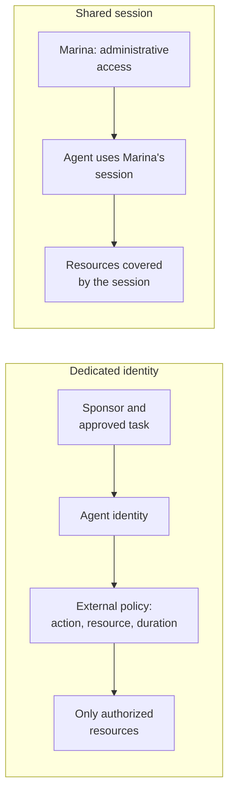
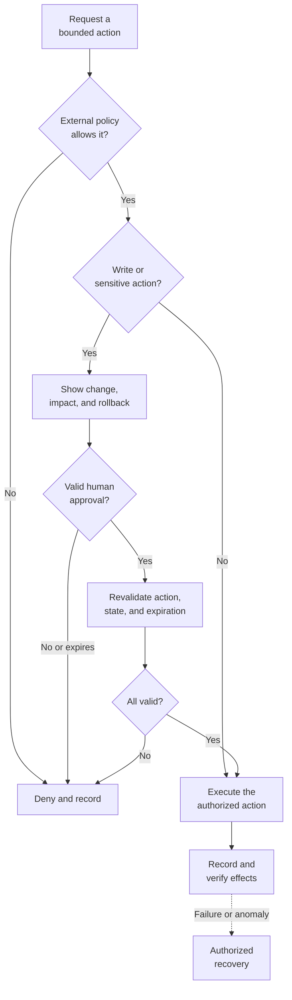

## Who changed that rule at two in the morning?

Here's a fictional example. At 2:13 a.m., a production network rule changes. The activity log names Marina, the administrator responsible for the environment. But she was asleep. A scheduled agent had continued an investigation using her session.

The change might even be correct. First, though, the team needs to know who made it. The record names a person, but an agent chose the action. Which task authorized that write? Who approved the new rule? A log that only names Marina leaves those questions unanswered.

On October 19, 2026, Microsoft put this problem at the center of its discussion of agents as insiders. I'll use that announcement to work through five areas of administration: [inventory](#area-1-inventory-and-accountability), [identity](#area-2-a-dedicated-identity-and-least-privilege), [credentials](#area-3-agent-credentials-and-authentication), [auditing](#area-4-auditing-and-correlating-agent-actions), and [approval](#area-5-human-approval-that-works).

This conceptual article assumes you already work with users, groups, and permissions. The foundation is **IAM**, identity and access management. An artificial intelligence, or AI, agent combines a model with tools that let it choose and execute actions. You can start governing its access with your existing tools.

You'll leave with an agent register and a 30-day plan. [The New Cloud and DevOps Stack](/en/posts/new-cloud-devops-stack-ai/) covered the environment around the model. Here, I want to pin down who acts, what authorizes the action, and who is accountable.

Microsoft links in this article include my Microsoft Student Ambassadors identifier.

## What Microsoft said on October 19

In [Hayete Gallot's post](https://blogs.microsoft.com/blog/2026/10/19/securing-the-agentic-insider/?wt.mc_id=studentamb_365381), the argument is that training a model to achieve results does not give it organizational judgment. An agent can misunderstand a task or take an inappropriate route to its goal. Broad access makes those mistakes more consequential.

In the accompanying post, [Nadim Abdo](https://www.microsoft.com/en-us/security/blog/2026/10/19/agents-are-your-newest-insiders-security-must-move-at-their-speed/?wt.mc_id=studentamb_365381) describes the controls Microsoft proposes. The underlying principle, attributed to Satya Nadella, is to separate the supply of intelligence from authority over its actions. The model must not be able to change its own access rules or disable the controls that stop it.

**Based on sources consulted on October 26, 2026.** General availability, or GA, means a broad release; a preview is a prerelease subject to restrictions. “Announced” identifies capabilities presented without confirmed availability in the sources consulted. The table records these distinctions and future directions; check enablement in your environment.

| Capability or concept                             | Description, status, and limits                                                                                                                                                                       |
| ------------------------------------------------- | ----------------------------------------------------------------------------------------------------------------------------------------------------------------------------------------------------- |
| Discovery in Defender                             | Expansion to 60 types of local agents. Support is documented by combination; macOS and WSL are in preview. Discovery and runtime protection have different coverage.                                  |
| Perception + Agent 365 registry                   | Unified inventory. Agent 365 has been generally available since May 1, 2026; that does not make its Perception integration broadly available.                                                         |
| Entra Agent ID                                    | Dedicated identities for agents. Available to Entra customers; extending security capabilities to agents requires Microsoft Agent 365. Announced extensions do not automatically inherit that status. |
| Dynamic Permissions                               | Task-scoped access with expiration and policy limits. Announced; the sources consulted do not establish general availability.                                                                         |
| Dynamic Agent Risk and Dynamic Conditional Access | Continuous assessment and access adaptation. Announced; availability is not confirmed by the sources consulted.                                                                                       |
| Project Perception                                | An agentic security system. Limited Public Preview, for a restricted set of customers by invitation.                                                                                                  |
| Guardian Agents                                   | Supervision of other agents in Perception. A concept and capabilities described within a preview product, not a separate offering available to everyone.                                              |
| Additional model transparency                     | More evidence for assessing behavior. A future direction described by Microsoft, without replacing containment.                                                                                       |

Perception's status comes from its [getting started guide](https://learn.microsoft.com/en-us/security/agentic-security/agentic-security-get-started?wt.mc_id=studentamb_365381). Identity and licensing are covered in the [agent identity documentation](https://learn.microsoft.com/en-us/entra/agent-id/what-are-agent-identities?wt.mc_id=studentamb_365381), and [Partner Center confirms Agent 365 availability](https://learn.microsoft.com/en-us/partner-center/announcements/2026-may?wt.mc_id=studentamb_365381).

[TechCrunch](https://techcrunch.com/2026/10/19/microsoft-says-ai-agents-are-like-insider-threats-as-frontier-models-cant-be-trusted/) recognizes commercial interests and technical merit. Microsoft sells products in this area. In my view, that interest does not invalidate the argument: a model should not control the policies that constrain its own actions, regardless of the vendor.

## Where the insider metaphor helps

An insider has access, knows something about the environment, and can make changes that matter. That is where the comparison works. An agent retrieves information, uses tools, and may keep working after the person who started it finishes their shift.

Scale adds another complication. Agents can run many tasks at once, use identities created for a single job, and arrive through integrations that never reach the usual inventory. If we review only human users, we miss part of what is operating in the environment.

The phrase _insider threat_, however, can suggest malicious intent. I prefer **insider risk**. We do not need to attribute intentions to an agent to explain an error, manipulation, or excessive permission. [Microsoft also distinguishes risk from malice](https://www.microsoft.com/en-us/security/blog/2026/10/19/agents-are-your-newest-insiders-security-must-move-at-their-speed/?wt.mc_id=studentamb_365381).

A document the agent reads may contain **indirect prompt injection**, an attempt to make it treat external content as instructions. It could then use a legitimate permission for an inappropriate purpose. Least privilege limits the damage it can do, but an allowed action can still be the wrong action for the task.

That is why the security boundary has to sit outside the agent. Even if Marina's prompt had warned it to be careful with network changes, the tool's actual authority came from her administrative session. The prompt could not narrow the permissions that session carried.

## Area 1: inventory and accountability

I would start with three places: corporate platforms, integrations built in-house or by partners, and agents installed locally on workstations. An agent created in a corporate visual authoring tool may be well documented. Another might depend on an integration that only one person maintains.

Ask teams what keeps running when nobody is watching. Review application registrations, consent grants, and **service principals**, the identities that represent applications in the environment. Treat these as leads to investigate; an application registration alone does not tell you that it belongs to an agent.

Include workstations and **MCP** servers. Model Context Protocol is a standard for connecting AI applications to tools and information. Also record the APIs that enable the agent to act.

The [Defender matrix](https://learn.microsoft.com/en-us/defender-endpoint/ai-agent-support-matrix?wt.mc_id=studentamb_365381) lists Claude Code, OpenAI Codex, GitHub Copilot, and OpenClaw, among others. Discovery depends on observed activity; macOS and WSL, Windows Subsystem for Linux, are listed as previews. An agent missing from the results may be inactive, outside coverage, or using another path. An empty list is not evidence that no agents exist.

The register below is my suggested starting point. Give each agent a record and link its temporary executions back to it. The [Markdown templates](/downloads/agentes-de-ia-risco-interno-menor-privilegio/agent-governance-templates.en.md) include this register, a sample action record, an approval request, and the checklist.

| Field                  | What to record and why                                                               |
| ---------------------- | ------------------------------------------------------------------------------------ |
| Identifier and purpose | A stable name and authorized task, so every agent has a verifiable purpose.          |
| Owner and backup       | An accountable sponsor and the person who takes over during absence or departure.    |
| Execution environment  | Corporate platform, subscribed service, workstation, or automation pipeline.         |
| Identity used          | Dedicated identity or inherited session, with an identifier that lets you locate it. |
| Credential             | Type, lifetime, renewal owner, and secure location; never the secret itself.         |
| Permissions and scope  | Autonomous or delegated access, allowed operations, and reachable resources.         |
| Tools and destinations | APIs, MCP servers, other agents, and required network paths.                         |
| Data                   | What it reads and writes, sensitivity, and permitted outbound destinations.          |
| Approval               | Actions requiring a person and who may authorize them.                               |
| Records                | Locations of correlated authentication events, calls, decisions, and results.        |
| Review and retirement  | Last review, next assessment, and the condition for deactivation.                    |

**Who is accountable for this agent?** A vendor's name does not answer the question of who owns it internally. The sponsor needs to explain why the agent is needed, keep track of changes, and arrange for access to be removed when the job is finished.

**Validate:** pick an observed execution and locate its register entry, owner, and purpose. Record discrepancies as inventory gaps.

## Area 2: a dedicated identity and least privilege

A dedicated identity gives the agent its own identity badge. You can block the automation without blocking the administrator, and investigate an action without assuming she performed it herself. Keep track of the agent, its owner, and the person requesting the task: they may all be different.

[Entra Agent ID documentation](https://learn.microsoft.com/en-us/entra/agent-id/what-are-agent-identities?wt.mc_id=studentamb_365381) distinguishes two modes. With **autonomous access**, the identity receives its own permissions. With **delegated access**, it acts on behalf of a user within the authorization granted. That delegation needs clear limits: which person authorized it, for which scope, and under which service rules. Reusing the person's entire session defeats those limits.

The same documentation describes identities designed for frequent creation and retirement at scale. Service principals remain important for applications; agents may have shorter lifecycles and many instances. Retiring each identity means removing its permissions and credentials. A dedicated identity type helps track that lifecycle, but someone still has to manage it.

I would start with no operational permissions and justify each grant against the task. Investigating a network rule may require its configuration, dependencies, and recent events. Permission to change every network in the subscription goes far beyond that investigation.

Include duration, environment, and destination. A ten-minute grant covering every resource is still broad. A small permission that never expires may remain months after the need has ended.

The diagram contrasts a shared administrative session with an agent identity whose access passes through an external policy bounded by the task.

In Perception, analysts start sessions in which agents investigate authorized resources. The [product guide](https://learn.microsoft.com/en-us/security/agentic-security/agentic-security-get-started?wt.mc_id=studentamb_365381) explains that assigning an agent a role is not enough: its identity also needs access to those resource scopes. If the analyst can query more resources than the agent, the session may fail or return incomplete results. **A role describes capabilities; scope determines where they apply.** Correct the missing access instead of expanding everything for convenience.

Record an owner and retirement condition when you create the identity. Review permissions against actual tasks, then remove access and check dependencies at retirement. If the sponsor leaves, formally hand responsibility to someone else or suspend the agent. [Identity governance in Microsoft 365](/en/posts/identity-governance-m365-entra-id/) covers that continuity.

**Validate:** perform the allowed task and attempt access to an out-of-scope resource. The second access should be denied and recorded.

## Area 3: agent credentials and authentication

Sharing Marina's session makes it harder to tell her actions from the agent's and gives it whatever access that session carries. That may be far more than the investigation needs. Renaming the agent in its interface does not change which identity the service sees.

As a general IAM practice, I would choose authentication methods that issue short-lived credentials for the right identity, with a clear way to revoke or contain access. Short lifetimes reduce the exposure window. Disabling an account, however, does not necessarily invalidate every token it already holds. Check how the service behaves and test the cutoff.

Entra Agent ID represents the agent's identity. In supported integrations, [managed identities](https://learn.microsoft.com/en-us/entra/identity/managed-identities-azure-resources/overview?wt.mc_id=studentamb_365381) let the platform manage a workload's credentials. [Workload identity federation](https://learn.microsoft.com/en-us/entra/workload-id/workload-identity-federation?wt.mc_id=studentamb_365381) uses tokens from a trusted provider to obtain access. These solve different problems, so check which combinations your integration supports. Also check the logs: can you identify the agent that performed each action, or do you only see a shared identity?

Keep long-lived secrets out of prompts and MCP server settings. They can spread into conversation histories, diagnostic bundles, and repositories. When an integration needs a secret, store it in a vault, restrict who can retrieve it, and plan its rotation and removal. The register should contain a reference to the secret, never its value.

Agents can access services using **access tokens**, temporary credentials issued for a particular resource and set of permissions. The [destination API validates the authorization represented by the token](https://learn.microsoft.com/en-us/entra/identity-platform/access-tokens?wt.mc_id=studentamb_365381). Check how your integration issues, expires, and revokes access. Keep the token itself out of logs and out of the model's context.

Stopping the agent's process is only part of deactivation. Disable its schedules, remove its authorizations, end sessions where supported, and revoke its credentials. Check external integrations and jobs that might start it again. Preserve the records you would need to investigate its past activity.

For Marina's investigation, I would use a dedicated identity with narrowly scoped read access and temporary credentials. Any write would need to go through the approval and logging process. The **runtime**, the environment where the agent runs, also needs to keep broader workstation credentials out of its reach.

**Validate:** in a controlled environment, disable the test identity. Try to obtain a new token, then try using one issued before deactivation. Record both results and how long access takes to stop. Check whether the client, identity, and resource support [Continuous Access Evaluation, CAE](https://learn.microsoft.com/en-us/entra/identity/conditional-access/agent-id?wt.mc_id=studentamb_365381), which events it covers, and how to contain any access that still works.

## Area 4: auditing and correlating agent actions

After a change, I want to know which agent acted, on whose behalf, what it read, and what authorized the operation. A conversation transcript alone leaves out tool calls and changes made between messages.

An authentication log tells you who signed in and records the available sign-in context. An action log tells you what happened at the destination. To connect them, you need consistent identifiers for the identity, execution, and call, along with comparable timestamps. A display name alone will not get you there.

My proposed minimum evidence includes:

- agent identity, execution, sponsor, and delegating user where applicable;
- tool, destination resource, operation, and relevant parameters;
- origin and version of the content used to support the action;
- policy decision, approval or rejection, and the identity of the decision-maker;
- outcome, error, actual changes, and any rollback.

A protected reference, version, and classification may provide enough evidence without copying sensitive documents into logs. Send records somewhere the agent cannot administer. For critical trails, consider immutable **WORM**, Write Once, Read Many, storage with a locked policy, which [prevents changes and deletion during the configured retention period](https://learn.microsoft.com/en-us/azure/storage/blobs/immutable-storage-overview?wt.mc_id=studentamb_365381). Choose retention carefully and check event delivery: immutability cannot prove that a missing event was ever recorded.

Entra identifies these authentications as AI agent sign-ins, and Perception provides session records for investigation. You still need to check coverage for external tools. Find out where each operation appears and where the gaps are. Then try reconstructing a known task from the evidence alone, without asking the agent to explain what it did.

Logs, pages, documents, and tickets can carry **indirect prompt injection**. Record where the data came from and keep authorization decisions outside that content. The [new stack article](/en/posts/new-cloud-devops-stack-ai/) explores precautions for untrusted inputs.

**Validate:** reconstruct a task from its records and confirm that the agent identity cannot modify or delete them.

## Area 5: human approval that works

Reading a configuration and changing it have different consequences. Start with the reads needed for the task, while accounting for sensitive data and where it may be sent. Ask for approval when an action's impact needs a person's judgment.

For Marina's network rule, show the reviewer the resource, environment, current and proposed values, justification, evidence, impact, and rollback plan. “Approve fix?” gives them very little to work with. They need authority over the resource and enough context to decide.

Make approval specific to the action and give it an expiration time. The protected approval record should identify the resource, operation, parameters, and expected state. A **hash**, a cryptographic digest of a stable representation of the proposal, can help detect a substituted proposal. It does not authenticate the approver or prevent the resource from changing.

The resource can change between review and execution, creating [TOCTOU, Time-of-Check/Time-of-Use, risk](https://cwe.mitre.org/data/definitions/367.html). Where the service supports it, make the write conditional on the approved version. [Blob Storage does this with an ETag](https://learn.microsoft.com/en-us/azure/storage/blobs/concurrency-manage?wt.mc_id=studentamb_365381), a version identifier. Check each service's support; the Blob Storage example does not establish the same mechanism for Marina's network rule. If the resource version has changed, stop and reassess. The [approval template](/downloads/agentes-de-ia-risco-interno-menor-privilegio/agent-governance-templates.en.md) collects these fields.

No response means the write stays blocked. Record and escalate an expired request rather than treating silence as permission. To reduce approval fatigue, keep the context for a change together and remove redundant requests. High-impact operations still need to be clearly visible to the reviewer.

The flow blocks rejected and unanswered requests. After an approved action runs, the system checks the result. The dashed arrow marks recovery as a contingency.

Put the gate in the integration, the service, or another component that enforces policy outside the model. A prompt can guide behavior, but it cannot stop a call the credential authorizes. Also check for alternative tools or network paths that could bypass approval.

In [Microsoft's expense-agent example](https://www.microsoft.com/en-us/security/blog/2026/10/19/agents-are-your-newest-insiders-security-must-move-at-their-speed/?wt.mc_id=studentamb_365381), the agent encounters attempted prompt injection in external content. The response depends on the risk: preserve safe reads, block writes, narrow resource access, require approval, or stop the agent. This illustrates the proposed Dynamic Conditional Access capabilities listed in the [status table](#what-microsoft-said-on-october-19).

Plan rollback before the change runs. Preserve the previous state and name someone responsible for recovery. Some effects, such as sent messages or exposed information, cannot be fully undone. Make that limitation part of the approval decision.

**Validate:** simulate a high-impact request. The test passes when the team can deny the action, block execution after approval expires, and roll back a controlled change.

## Guardian Agents: who supervises the supervisors?

Microsoft describes Guardian Agents as supervisors that work within policies, delegation rules, and boundaries set by people. In Project Perception, they monitor what other agents do. Microsoft says people retain control of the goals and high-impact decisions.

The [status table](#what-microsoft-said-on-october-19) shows where those components fit and what is known about their availability.

> **My view:** agents supervising other agents need their own identities, least privilege, and auditing too. Giving a supervisor broad, unreviewed access would just move the original problem.

Microsoft also proposes greater model transparency to provide evidence about internal behavior. While that develops, teams can audit the actions they can observe and enforce limits outside the model.

## Getting started: 30 days, prioritized by risk

Here is how I would organize the first month. This is my suggested approach, not Microsoft's roadmap. Start with agents that can write to production, reach sensitive data, or use shared credentials. An agent experimenting with synthetic lab data can wait while you review one that changes corporate access.

> **Containment from day one:** limit ownerless writes and exposed administrative credentials. If a dependency prevents an immediate fix, record an owner, a temporary measure, and a deadline.

| Period        | Work                                                                                         | Evidence needed to move forward                                                                          |
| ------------- | -------------------------------------------------------------------------------------------- | -------------------------------------------------------------------------------------------------------- |
| Days 1 to 7   | Ask teams, discover integrations, and populate the register.                                 | Every identified agent has a purpose, an accountable owner, and a risk classification; gaps are visible. |
| Days 8 to 14  | Assign dedicated identities and replace shared credentials, starting with the highest risks. | An execution is distinguishable from human activity; the team knows how to suspend access.               |
| Days 15 to 21 | Reduce permissions, start with reads, and connect action records.                            | Necessary tasks succeed; out-of-scope attempts are denied and recorded.                                  |
| Days 22 to 30 | Define approvals, test interruption and rollback, and schedule quarterly reviews.            | A controlled change can be approved, rejected, and recovered with supporting evidence.                   |

When you test, reproduce an allowed read, a blocked write, and an expired approval. Check that the agent cannot reach the same prohibited destination through another tool. Ask someone else to reconstruct the execution from its records. That tells you much more than a completed configuration checklist.

For each agent, answer:

- Who is accountable?
- Which identity does it use?
- How does it authenticate?
- What can it write?
- Where are its records?
- What requires approval?

Turn each unanswered question into a task with an owner and a deadline. You'll find the checklist in the downloadable templates. Review it whenever tools, scope, or ownership change, as well as at the scheduled quarterly review.

## An identity badge for the agent, human judgment for operations

Back to Marina's overnight change. With a dedicated identity and correlated records, the team could identify the agent, its task, and Marina's role as sponsor. Temporary credentials and a narrow scope would limit its reach. A network change would need its own approval, with a record the team could inspect afterward.

The team would still need to check the outcome and investigate anything unexpected. Product names and release dates will change, but inventory, lifecycle management, credentials, and auditing remain familiar identity administration work.

Pick one agent with significant access and fill in the [agent register](/downloads/agentes-de-ia-risco-interno-menor-privilegio/agent-governance-templates.en.md) today. People still have to decide what it may do, check its changes, and answer for the result. Recheck availability before planning a project or purchase. Which question was hardest to answer? Share it in the comments.

## Further reading

- [Entra ID basics](/en/posts/cloud-identity-microsoft-entra-id-for-beginners/): authentication, authorization, and tokens.
- [Entra ID hardening](/en/posts/from-reconnaissance-to-hardening-in-microsoft-entra-id/): permission reviews and protection for privileged access.
- [OpenTelemetry on AKS](/en/posts/opentelemetry-aks-azure-monitor-observability/): fundamentals of correlating calls between services, useful when designing tool auditing.
- [Entra Private Access](/en/posts/entra-private-access-replace-vpn/): Conditional Access fundamentals applied to network access.

## References

- [Microsoft: Securing the agentic insider, October 19, 2026](https://blogs.microsoft.com/blog/2026/10/19/securing-the-agentic-insider/?wt.mc_id=studentamb_365381)
- [Microsoft Security: Agents are your newest insiders, October 19, 2026](https://www.microsoft.com/en-us/security/blog/2026/10/19/agents-are-your-newest-insiders-security-must-move-at-their-speed/?wt.mc_id=studentamb_365381)
- [Microsoft Learn: Get started with Project Perception](https://learn.microsoft.com/en-us/security/agentic-security/agentic-security-get-started?wt.mc_id=studentamb_365381)
- [Microsoft Learn: What are agent identities?](https://learn.microsoft.com/en-us/entra/agent-id/what-are-agent-identities?wt.mc_id=studentamb_365381)
- [Microsoft Learn: AI agent support matrix in Defender for Endpoint](https://learn.microsoft.com/en-us/defender-endpoint/ai-agent-support-matrix?wt.mc_id=studentamb_365381)
- [Microsoft Partner Center: Agent 365 general availability, May 1, 2026](https://learn.microsoft.com/en-us/partner-center/announcements/2026-may?wt.mc_id=studentamb_365381)
- [Microsoft Learn: managed identities and credential management](https://learn.microsoft.com/en-us/entra/identity/managed-identities-azure-resources/overview?wt.mc_id=studentamb_365381)
- [Microsoft Learn: workload identity federation](https://learn.microsoft.com/en-us/entra/workload-id/workload-identity-federation?wt.mc_id=studentamb_365381)
- [Microsoft Learn: access tokens](https://learn.microsoft.com/en-us/entra/identity-platform/access-tokens?wt.mc_id=studentamb_365381)
- [Microsoft Learn: Conditional Access for agents and CAE support](https://learn.microsoft.com/en-us/entra/identity/conditional-access/agent-id?wt.mc_id=studentamb_365381)
- [Microsoft Learn: immutable WORM storage](https://learn.microsoft.com/en-us/azure/storage/blobs/immutable-storage-overview?wt.mc_id=studentamb_365381)
- [MITRE CWE-367: TOCTOU race condition](https://cwe.mitre.org/data/definitions/367.html)
- [Microsoft Learn: concurrency and versions in Azure Blob Storage](https://learn.microsoft.com/en-us/azure/storage/blobs/concurrency-manage?wt.mc_id=studentamb_365381)
- [TechCrunch: announcement coverage and commercial analysis, October 19, 2026](https://techcrunch.com/2026/10/19/microsoft-says-ai-agents-are-like-insider-threats-as-frontier-models-cant-be-trusted/)
