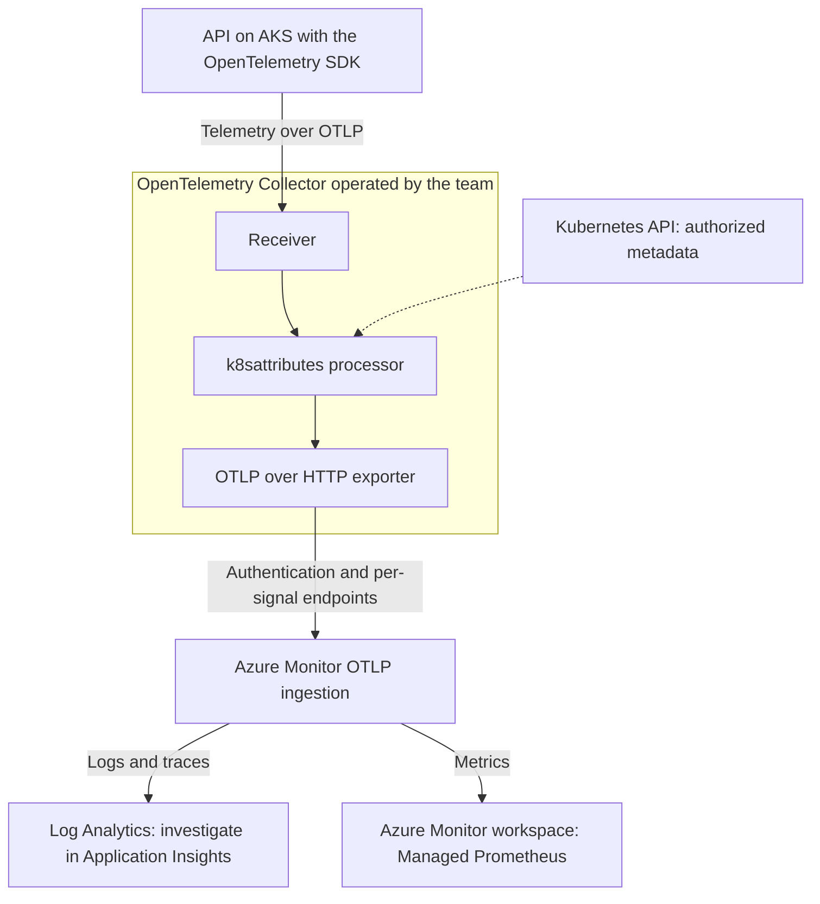
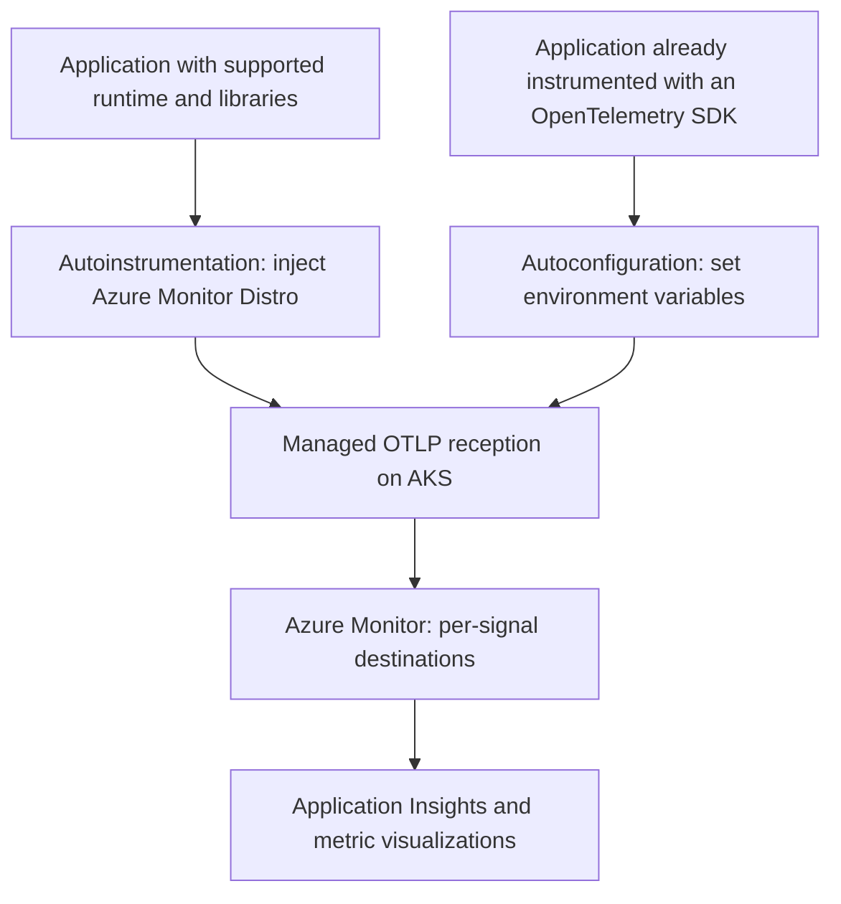

## Introduction: your app is running on AKS, so what happens when it fails?

In [Kubernetes in practice with AKS](/en/posts/kubernetes-in-practice-with-aks-container-pod-service-ingress/), a Node.js API moved from a container into a Pod, Deployment, Service, and Ingress. An HTTP response confirmed that traffic could reach the application. The next question appears when it responds correctly almost all the time. The problem lives in that “almost.”

Imagine a fictional next version of that API. It now calls an inventory service. After a deployment, some requests slow down and others fail. The Pods remain healthy enough to run. The team reads logs from different containers, compares timestamps, and tries to work out whether the errors belong to the same request. By the time someone finds a clue, the Pod that emitted it has been replaced.

What is missing is context for the investigation. This first RookieOps article dedicated to observability lays out the pieces that can restore it: instrumentation, the OpenTelemetry Collector, Kubernetes metadata, and Azure Monitor. The Kubernetes attributes processor reaching v1.0 in September 2026 offers a timely reason to discuss an architecture that will remain useful after the announcement fades.

You only need to be familiar with Pods, Deployments, and Services. By the end, you should be able to draw the telemetry path and explain who produces, enriches, transports, and presents each signal. This is a conceptual analysis based on sources checked on **September 27 and 28, 2026**, not a lab, deployment guide, or original benchmark. The incident is illustrative.

## Observability is more than three kinds of data

A useful definition of observability is the ability to ask new questions about a system's behavior using the telemetry already available, without shipping new code for every investigation. The [OpenTelemetry observability primer](https://opentelemetry.io/docs/concepts/observability-primer/) ties this capability to instrumentation quality. When information was never recorded, a tool cannot reconstruct it on demand.

For our API, the questions are specific: did the problem begin with the new version? Does it affect every Pod? Was the time spent inside the application or waiting for inventory? A cluster-wide CPU chart cannot answer those questions by itself.

| Signal  | What it records                                         | Question in our scenario                        |
| ------- | ------------------------------------------------------- | ----------------------------------------------- |
| Logs    | Events with timestamps, messages, and contextual fields | Which error was recorded during that operation? |
| Metrics | Numeric measurements aggregated over time               | Did the failure rate increase after deployment? |
| Traces  | Related operations making up one request                | Which call consumed the time?                   |

Each operation within a trace is a **span**, with its own duration and attributes. Following a request across services requires the instrumentation to propagate context. The trace ID identifies the request's path; a span ID identifies one operation along that path. Compatible logging libraries can record these identifiers, allowing an error to lead you to its trace. The [context propagation guide](https://opentelemetry.io/docs/concepts/context-propagation/) explains the connection.

Another connection describes where the data came from. Resource attributes such as `service.name`, namespace, and Pod identity help distinguish applications sharing the same infrastructure. The logical service name should remain recognizable even as replicas come and go. The [resources documentation](https://opentelemetry.io/docs/concepts/resources/) separates that identity from the details of individual operations.

I would start the investigation with the failure rate and narrow the time window to the deployment. Then I would inspect slow traces from that version and their associated logs. The metric shows the scale of the problem; individual examples let us test an explanation. If collection retained only successful calls, that investigation has a gap the team must acknowledge.

Do not put a trace ID on every metric series as a regular label. The number of combinations would keep growing. Correlation can rely on service, version, and time window; exemplars, where supported, are metric samples that reference specific traces. Sampling decisions also determine which request paths remain available. Those details separate a useful dashboard from a chart that merely confirms someone is complaining.

## Why an open standard helps instrumentation

OpenTelemetry, or OTel, grew from the merger of OpenTracing and OpenCensus in 2019. The CNCF [announced its graduation on May 21, 2026](https://www.cncf.io/announcements/2026/05/21/cloud-native-computing-foundation-announces-opentelemetrys-graduation-solidifying-status-as-the-de-facto-observability-standard/). It now has Graduated project status, a maturity category also associated with projects such as Kubernetes and Prometheus. That statement concerns the project and its governance; the status of individual components still needs to be checked separately.

For the API team, the practical benefit is preserving its investment in instrumentation. When operations are recorded with OTel APIs and SDKs and signals travel over **OTLP**, the OpenTelemetry Protocol, the application can keep producing the same data if the destination changes. Exporters, authentication, and configuration bridge the application to the chosen backend.

This portability covers instrumentation and transport. Dashboards, queries, alerts, and vendor-specific features may still need to be adapted when a destination changes. It reduces the coupling between code that describes an operation and the service that stores and analyzes its telemetry; it does not make every backend interface interchangeable.

I would treat service names, attributes, and the meaning of operations as a team contract. “Inventory lookup” should mean the same thing before and after a tool migration. If each destination requires a different interpretation, the transport standard helped, but the work of standardizing the data remains.

## The anatomy of OpenTelemetry inside the cluster

### SDKs, instrumentation, and the Collector

Instrumentation observes application operations. It may be added in code or provided by libraries that recognize common frameworks and clients. APIs expose the interfaces used to record signals; SDKs implement processing and export inside the application process. The [OpenTelemetry components overview](https://opentelemetry.io/docs/concepts/components/) distinguishes these roles.

The **Collector** is a separate process. It receives telemetry, transforms it, and forwards it. The application still needs to record the business operations worth investigating. Historical storage and a query interface remain backend responsibilities.

A Collector pipeline has three kinds of component: **receivers** accept or collect data; **processors** transform, filter, or enrich it; **exporters** send it to the next destination. The `k8sattributes` processor belongs to the enrichment stage. The [Collector architecture](https://opentelemetry.io/docs/collector/architecture/) lets you compose different pipelines for different signals.

The diagram shows one possible architecture with a Collector operated by the team. The exporter is part of that Collector. Azure storage destinations are shown separately so it is clear where each signal ends up.

This diagram does not describe the internals of the managed AKS add-on. Microsoft operates its own integration components there. Selecting that add-on does not automatically install the latest version of every community processor.

### One agent per node or a shared aggregation point

As a **DaemonSet**, the Collector can run an agent on each eligible node. That supports collection close to the source, such as log files and node metrics. As a **Deployment**, it can serve as a shared gateway receiving data from applications or other Collectors. The [agent](https://opentelemetry.io/docs/collector/deploy/agent/) and [gateway](https://opentelemetry.io/docs/collector/deploy/gateway/) patterns can coexist.

For the inventory API, I would begin by drawing the simplest path that supports the investigation. An additional layer can centralize filtering and export, but it also needs resources, supervision, and a plan for downstream outages. The team should know where data waits and how to detect losses before blaming the application for silence.

The topology also affects source identification. If a gateway receives everything from an intermediate agent, the connection's IP address may identify that agent rather than the original Pod. A trustworthy Pod identity, such as its UID, must be preserved and the association configured accordingly. The [Kubernetes Collector components guide](https://opentelemetry.io/docs/platforms/kubernetes/collector/components/) helps match a topology to the data being collected.

## The processor that adds cluster context has reached v1.0

The **Kubernetes attributes processor**, named `k8sattributes`, associates telemetry with cluster objects and adds metadata to their resources. Available in the `contrib` and `k8s` Collector distributions, it can identify the Pod, namespace, node, and Deployment. Additional labels and annotations depend on extraction configuration. To extract node labels, the Collector's `ServiceAccount` needs cluster-scoped RBAC permissions on `nodes`, typically through a `ClusterRole`; a namespace-only `Role` is insufficient. Namespace labels also require cluster-scoped access, as the [component README](https://github.com/open-telemetry/opentelemetry-collector-contrib/blob/main/processor/k8sattributesprocessor/README.md) explains.

That context can survive a Pod being replaced, provided the data was collected and retained. The team can compare the same application across namespaces, versions, and replicas. An error message stops being a note with no sender.

### What stability means here

The [September 16, 2026 announcement](https://opentelemetry.io/blog/2026/k8s-attributes-processor-v1/) introduces the module at v1.0.0. The classification involves tests, benchmarks, documentation, and telemetry stability. The [Collector's stability criteria](https://github.com/open-telemetry/opentelemetry-collector/blob/7d1c25d46b14cce04a820d92a4ce462bf7a04b0b/docs/component-stability.md) establish compatibility commitments, including API compatibility, within its versioning policy. Teams should still plan for fixes and future migrations.

The path to that milestone ran through semantic conventions: shared names and meanings for producers and consumers. The Kubernetes set reached [Release Candidate in March](https://opentelemetry.io/blog/2026/k8s-semconv-rc/), and core Kubernetes resource and container registry attributes stabilized in [v1.42.0 in June 2026](https://github.com/open-telemetry/semantic-conventions/releases/tag/v1.42.0). The [system metrics section](https://opentelemetry.io/docs/specs/semconv/system/) is still in development; attribute stability does not automatically extend to every Kubernetes metric.

Keep three versions separate: the `k8sattributes` module (v1.0.0), the Collector distribution, and the semantic conventions aligned with this milestone (v1.42.0). CNCF graduation, processor stability, and the availability of an Azure integration are separate commitments.

### Migration still takes work

The [v1.0.0 compatibility guide](https://pkg.go.dev/github.com/open-telemetry/opentelemetry-collector-contrib/processor/k8sattributesprocessor@v1.0.0#readme-semantic-conventions-compatibility) documents changes such as `k8s.pod.labels.<key>` to `k8s.pod.label.<key>` and `container.image.tag` to `container.image.tags`. Both migration feature gates are enabled by default, so the processor emits only the new scheme. Temporarily disabling `processor.k8sattributes.DontEmitV0K8sConventions` allows both schemes to be emitted during the transition.

A query that depends on an old name stops capturing new telemetry after an upgrade with the default settings unless dual emission is active. I would therefore inspect the attribute from extraction through to the alert that depends on it. Compare data from a pilot version, adjust consumers, and only then broaden the upgrade. Stability makes subsequent changes more predictable; reaching it still carries a migration cost.

In our API scenario, the advantage shows up in a dashboard that groups failures by Deployment. A more stable attribute contract lowers the chance of losing that view during a future Collector upgrade. The team must still verify that the metadata identifies the right workload.

## Where Azure Monitor fits and what is still in preview

**Azure Monitor** brings together collection, storage, and analysis services. **Application Insights** provides experiences for investigating application behavior within that ecosystem. The **Microsoft Distro** packages OpenTelemetry components and Microsoft integrations; the community SDK remains a distinct choice.

The [current Microsoft options matrix](https://learn.microsoft.com/en-us/azure/azure-monitor/containers/opentelemetry-options?wt.mc_id=studentamb_365381) distinguishes ingestion from instrumentation; these paths are not direct substitutes:

| Component or path                           | Role                                      | Status on September 28, 2026 |
| ------------------------------------------- | ----------------------------------------- | ---------------------------- |
| Microsoft OpenTelemetry Distro              | Client instrumentation                    | GA                           |
| OTLP ingestion with OpenTelemetry Collector | Team-operated pipeline to Azure Monitor   | GA                           |
| OTLP ingestion with Azure Monitor Agent     | Local reception on VMs and Arc servers    | Preview                      |
| AKS application integration                 | Managed application onboarding in cluster | Preview                      |

GA means general availability. The Distro's maturity does not make the AKS add-on GA.

The [data collection overview](https://learn.microsoft.com/en-us/azure/azure-monitor/containers/collect-use-observability-data?wt.mc_id=studentamb_365381) still labels the Collector path as preview. For availability status, this article follows the options matrix, which classifies it as GA.

> [!IMPORTANT]
> As of September 28, 2026, managed application integration on AKS is still in preview, without an SLA or a Microsoft recommendation for production workloads. [Limitations in the AKS guide](https://learn.microsoft.com/en-us/azure/azure-monitor/containers/kubernetes-open-protocol?wt.mc_id=studentamb_365381) include Windows node pools, namespaces using Istio mTLS, and compression in SDK exporters. The [data collection overview](https://learn.microsoft.com/en-us/azure/azure-monitor/containers/collect-use-observability-data?wt.mc_id=studentamb_365381) also lists Linux Arm64 node pools as unsupported. Deployments need a restart after onboarding to receive the changes.

The naming is also in transition. The [options matrix](https://learn.microsoft.com/en-us/azure/azure-monitor/containers/opentelemetry-options?wt.mc_id=studentamb_365381) describes the **Microsoft OpenTelemetry Distro**, with official support for **.NET, Node.js, and Python**. [AKS onboarding](https://learn.microsoft.com/en-us/azure/azure-monitor/containers/kubernetes-codeless?wt.mc_id=studentamb_365381) calls the injected components **Azure Monitor OpenTelemetry Distro** and documents Java and Node.js. This article uses each path's name; a package's availability does not establish support for automatic injection on AKS.

With a team-operated Collector, the [official export example](https://learn.microsoft.com/en-us/azure/azure-monitor/containers/opentelemetry-protocol-ingestion?wt.mc_id=studentamb_365381) uses components from the `contrib` project, which includes `k8sattributes`, and the `azure_auth` extension for Microsoft Entra authentication. The guide also allows a custom distribution built with Collector Builder. The identity needs write permission on the Data Collection Rule (DCR). The team configures routing and remains responsible for the community components it operates.

### Managed application integration on AKS

The [AKS-specific onboarding guide](https://learn.microsoft.com/en-us/azure/azure-monitor/containers/kubernetes-open-protocol?wt.mc_id=studentamb_365381) combines cluster monitoring, OTLP-enabled Application Insights, and application association by namespace or Deployment. Managed workspaces provision the needed destinations: Log Analytics for logs and traces, and an Azure Monitor workspace for Prometheus metrics. The application metrics workspace should be separate from the infrastructure metrics workspace.

The two metrics workspaces answer different questions:

- **Infrastructure:** holds metrics about cluster health, nodes, and resource pressure. The platform team typically owns this view.
- **Application:** holds metrics from instrumented requests and operations. It helps the development team investigate service behavior.

In our example, a healthy node can still host a process that waits too long for a dependency. Logs and traces go to Log Analytics. The onboarding association helps navigate between views, but the team should check which Kubernetes attributes actually reached the application data.

I would assign responsibility for the cluster and shared destinations to the platform team. The application team would choose meaningful operations, their attributes, and what counts as a failure. Both teams need an agreement on naming, retention, and how to investigate missing data.

### Autoinstrumentation and autoconfiguration

With **autoinstrumentation**, the platform injects Azure Monitor OpenTelemetry Distro components to observe supported libraries without requiring every technical operation to be instrumented by hand. The [AKS documentation](https://learn.microsoft.com/en-us/azure/azure-monitor/containers/kubernetes-codeless?wt.mc_id=studentamb_365381) covers Java and Node.js. Autoinstrumentation support for [.NET and Python](https://learn.microsoft.com/en-us/azure/azure-monitor/containers/kubernetes-codeless-python-net?wt.mc_id=studentamb_365381) remains in limited public preview.

With **autoconfiguration**, the application already has OpenTelemetry instrumentation. The platform adjusts environment variables to point its SDKs at the managed path. Without an SDK already present, there is no application instrumentation to configure, and this step will not create new business operations.

The arrows converge on the same reception integration, not on a promise that every signal uses one URL and one port. On this path, the team does not need to operate a community Collector. The first diagram shows the self-managed alternative, not the add-on's internals.

For the fictional Node.js API, I would consider autoinstrumentation if the first priority were visibility into supported requests and dependencies. If the team already maintains OpenTelemetry instrumentation, autoconfiguration is the natural choice because it uses the existing SDK without injecting another Distro.

Two coexistence cases should not be confused. [Microsoft says](https://learn.microsoft.com/en-us/azure/azure-monitor/containers/kubernetes-codeless?wt.mc_id=studentamb_365381) that autoinstrumentation prevents duplicate data when used alongside the Azure Monitor OpenTelemetry Distro or the classic Application Insights SDK. An open-source OpenTelemetry SDK exporting to third parties is a different case: injection can disrupt that export. When instrumentations coexist, manual instrumentation takes precedence in Node.js; autoinstrumentation does in Java. Custom Node.js metrics require manual instrumentation with the Azure Monitor OpenTelemetry Distro.

In the portal, a namespace gets either autoinstrumentation **or** autoconfiguration. To combine both choices within one namespace, onboard by Deployment, as described in the [AKS guide](https://learn.microsoft.com/en-us/azure/azure-monitor/containers/kubernetes-open-protocol?wt.mc_id=studentamb_365381).

### OTLP ports and transport: 4317, 4318, and 4319

The conventional OTLP ports are **4317 for gRPC and 4318 for HTTP**. They describe the protocol, not every deployment's actual configuration. On the specific [Azure Monitor Agent path for machines](https://learn.microsoft.com/en-us/azure/azure-monitor/containers/opentelemetry-ingest-agent?wt.mc_id=studentamb_365381), local gRPC reception uses 4317 for metrics and **4319 for logs and traces**. Port 4319 belongs to that implementation on VMs and Azure Arc-enabled servers; it is not a generic AKS port.

In its **Change protocol** section, the [AKS-specific guide](https://learn.microsoft.com/en-us/azure/azure-monitor/containers/kubernetes-open-protocol?wt.mc_id=studentamb_365381) says autoconfiguration uses `http/protobuf` by default and shows how to select gRPC. Its **Limits** section says the feature accepts OTLP/HTTP or OTLP/gRPC with binary Protobuf, not JSON. The documentation is inconsistent, however: the [data collection overview](https://learn.microsoft.com/en-us/azure/azure-monitor/containers/collect-use-observability-data?wt.mc_id=studentamb_365381) describes AKS integration as HTTP/protobuf only, without gRPC. Confirm the available transport in your preview environment before configuring the exporter. Do not copy an address, transport, or format from another path.

## Once the data arrives: where do you look?

Application Insights **Performance**, **Failures**, **Search**, and **Transaction details** experiences help investigate duration, errors, and related operations. The guide to [using OTel data](https://learn.microsoft.com/en-us/azure/azure-monitor/containers/collect-use-observability-data?wt.mc_id=studentamb_365381) also notes an important difference: Live Metrics is unavailable on this OTLP path.

Logs and traces land in Log Analytics under a schema based on OTel conventions. The [OTelSpans table](https://learn.microsoft.com/en-us/azure/azure-monitor/reference/tables/otelspans?wt.mc_id=studentamb_365381), for example, documents received spans. Check `ResourceAttributes` and the matching `OTelResources` record linked by `ResourceAttributesId` to see whether the expected `k8s.*` attributes were ingested. Existing queries should be checked against the actual schema. Changing an ingestion destination alone does not guarantee that old table names still apply.

For metrics, the Azure Monitor workspace supplies Prometheus storage. [Grafana dashboards in Application Insights](https://learn.microsoft.com/en-us/azure/azure-monitor/app/grafana-dashboards?wt.mc_id=studentamb_365381) are integrated into the portal; Azure Managed Grafana is a separate option. On the OTel path, [Metrics Explorer may require manually written PromQL](https://learn.microsoft.com/en-us/azure/azure-monitor/containers/collect-use-observability-data?wt.mc_id=studentamb_365381).

The built-in experiences expect metrics with **delta temporality**, referring to the exported interval, and exponential histograms, which group measurements into ranges. AKS onboarding sets these options automatically. In a custom pipeline, the team must check that contract so the dashboards interpret aggregations correctly. If the source emits cumulative metrics, the [Azure Monitor Collector guide](https://learn.microsoft.com/en-us/azure/azure-monitor/containers/opentelemetry-protocol-ingestion?wt.mc_id=studentamb_365381) points to the `cumulativetodelta` processor for conversion.

For our API, I would open a slow trace from the period when failures increased. If most of the delay is in the inventory call, I would compare examples from different replicas and versions. A correlated log might explain the timeout. This sequence tests a hypothesis; two charts rising together do not prove causation.

### How to tell whether observability is helping

Before expanding collection, I would require a few straightforward pieces of evidence from the pilot:

- a known request can be located by service, version, and Kubernetes origin;
- logs emitted within the operation lead to the expected trace;
- a controlled failure appears both in the investigation and the aggregate indicator;
- after a Pod is replaced, previously sent data still identifies its source;
- the team recognizes export losses and the effects of sampling.

I would also decide which data must stay out of telemetry, including tokens and request bodies containing personal information. Volume, cardinality, and retention affect cost and performance even though we are not discussing prices here. To roll back a pilot, the team needs to restore the previous instrumentation configuration and retain enough data for comparison.

## Conclusion: the next step after getting an app running on AKS

The API still relies on Pods, Services, and networking to serve requests. Now the team can ask which replica emitted an error, follow the operation into inventory, and compare it with the previous version. That depends on signals being produced and correlated correctly, and on a reliable route from the application to analysis.

The SDK runs in the application; the Collector receives and processes data; `k8sattributes` adds cluster context; a Distro packages instrumentation and integration choices; Application Insights provides investigation experiences. Understanding the division helps locate both application defects and failures in the telemetry pipeline itself.

I would start with one important operational question and one small application. The stable processor improves the predictability of the metadata contract. The chosen platform must demonstrate that it preserves that contract all the way to the investigation. A future article could turn this design into a lab, with configuration, validation, and resource cleanup.

What slows investigations down most in your cluster: finding the right Pod, correlating logs with traces, or noticing that collection dropped data? Tell me in the comments. Your experience could help shape that future lab.

## References

Primary sources checked on September 27 and 28, 2026. Links throughout the article support specific claims. For the main decisions, start here:

- [Observability fundamentals](https://opentelemetry.io/docs/concepts/observability-primer/).
- [Kubernetes attributes processor v1.0](https://opentelemetry.io/blog/2026/k8s-attributes-processor-v1/).
- [Semantic convention compatibility in v1.0.0](https://pkg.go.dev/github.com/open-telemetry/opentelemetry-collector-contrib/processor/k8sattributesprocessor@v1.0.0#readme-semantic-conventions-compatibility).
- [OpenTelemetry paths and availability in Azure Monitor](https://learn.microsoft.com/en-us/azure/azure-monitor/containers/opentelemetry-options?wt.mc_id=studentamb_365381).
- [AKS application OTLP integration](https://learn.microsoft.com/en-us/azure/azure-monitor/containers/kubernetes-open-protocol?wt.mc_id=studentamb_365381).
- [Direct ingestion with an OpenTelemetry Collector](https://learn.microsoft.com/en-us/azure/azure-monitor/containers/opentelemetry-protocol-ingestion?wt.mc_id=studentamb_365381).
