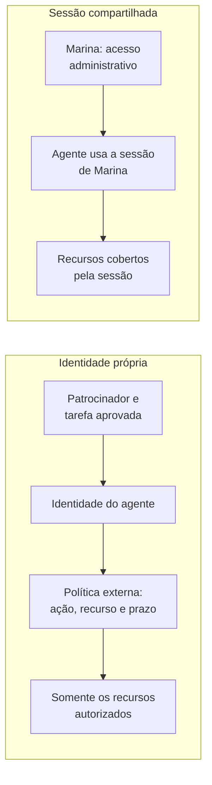
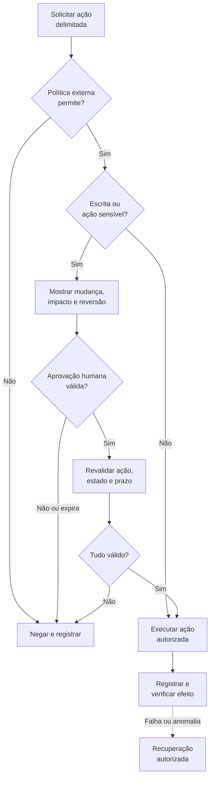

## Quem fez essa alteração às duas da manhã?

Vamos partir de um exemplo fictício. Às 2h13, uma regra de rede em produção é alterada. O log de atividade mostra o nome de Marina, administradora responsável pelo ambiente. Ela estava dormindo. Um agente agendado continuou uma investigação usando a sessão que Marina havia deixado disponível.

A mudança até poderia estar correta. Mas o registro atribui a operação a Marina, enquanto foi o agente que a escolheu. Qual tarefa autorizava aquela alteração? Quem aprovou o destino e a nova regra? O nome no log, sozinho, não responde.

Em 19 de outubro de 2026, a Microsoft trouxe esse problema para a discussão sobre agentes como participantes internos. O anúncio é o ponto de partida para cinco frentes: [inventário](#frente-1-inventário-e-responsabilidade), [identidade](#frente-2-identidade-própria-e-menor-privilégio), [credenciais](#frente-3-credenciais-e-autenticação-de-agentes), [auditoria](#frente-4-auditoria-e-correlação-de-ações) e [aprovação](#frente-5-aprovação-humana-que-funciona).

Quem administra usuários, grupos e permissões conhece a base: **IAM**, gestão de identidades e acessos. Um agente de inteligência artificial, ou IA, combina um modelo com ferramentas para escolher e executar ações. Aqui, vamos aplicar esses fundamentos à governança dos agentes.

Preparei um registro de agentes e um plano de 30 dias. [A nova stack de Cloud e DevOps](/posts/nova-stack-cloud-devops-ia/) aborda o ambiente ao redor do modelo. O foco é saber quem age, com qual autorização e sob responsabilidade de quem.

_Os links Microsoft deste artigo incluem meu identificador do programa Microsoft Student Ambassadors._

## O que a Microsoft disse em 19 de outubro

Para [Hayete Gallot](https://blogs.microsoft.com/blog/2026/10/19/securing-the-agentic-insider/?wt.mc_id=studentamb_365381), buscar um resultado não equivale a decidir o que faz sentido para a organização. Um agente pode interpretar mal uma tarefa ou escolher um caminho inadequado. Conceder acesso amplo com base na expectativa de bom comportamento deixa a segurança dependente do modelo.

O texto complementar de [Nadim Abdo](https://www.microsoft.com/en-us/security/blog/2026/10/19/agents-are-your-newest-insiders-security-must-move-at-their-speed/?wt.mc_id=studentamb_365381) descreve controles para esse cenário. O princípio, atribuído pela Microsoft a Satya Nadella, é separar o fornecimento de inteligência da autoridade sobre as ações. Permissões e interrupções precisam ser aplicadas onde o modelo não possa modificá-las.

**Conforme as fontes consultadas em 26/10/2026.** Disponibilidade geral, ou GA, indica lançamento amplo; preview é uma prévia sujeita a restrições. “Anunciado” identifica capacidades apresentadas sem disponibilidade confirmada nas fontes consultadas. A tabela registra essas diferenças e as direções futuras; confira a habilitação no seu ambiente.

| Recurso ou conceito                             | Descrição, status e limite                                                                                                                                                                         |
| ----------------------------------------------- | -------------------------------------------------------------------------------------------------------------------------------------------------------------------------------------------------- |
| Descoberta no Defender                          | Ampliação para 60 tipos de agentes locais. Suporte documentado por combinação; macOS e WSL em preview. Descoberta e proteção durante a execução têm coberturas diferentes.                         |
| Registro Perception + Agent 365                 | Inventário unificado. Agent 365 em disponibilidade geral desde 01/05/2026; isso não torna a integração com Perception amplamente disponível.                                                       |
| Entra Agent ID                                  | Identidade própria para agentes. Disponível para clientes Entra; estender recursos de segurança a agentes requer Microsoft Agent 365. Extensões anunciadas não herdam automaticamente esse status. |
| Dynamic Permissions                             | Acesso por tarefa, com prazo e limites de política. Anunciado; as fontes consultadas não estabelecem disponibilidade geral.                                                                        |
| Dynamic Agent Risk e Dynamic Conditional Access | Avaliação contínua e adaptação do acesso. Anunciados; disponibilidade não confirmada pelas fontes consultadas.                                                                                     |
| Project Perception                              | Sistema de segurança com agentes. Limited Public Preview, para um conjunto restrito de clientes por convite.                                                                                       |
| Guardian Agents                                 | Supervisão de outros agentes no Perception. Conceito e capacidades descritos no contexto de um produto em preview; não é oferta independente disponível a todos.                                   |
| Transparência adicional do modelo               | Mais evidências para avaliar seu comportamento. Direção futura descrita pela Microsoft, sem substituir contenção.                                                                                  |

O status do Perception vem do [guia de início](https://learn.microsoft.com/en-us/security/agentic-security/agentic-security-get-started?wt.mc_id=studentamb_365381). Identidade e licenciamento estão na [documentação de identidades de agentes](https://learn.microsoft.com/en-us/entra/agent-id/what-are-agent-identities?wt.mc_id=studentamb_365381), e o [Partner Center confirma a disponibilidade do Agent 365](https://learn.microsoft.com/en-us/partner-center/announcements/2026-may?wt.mc_id=studentamb_365381).

O [TechCrunch](https://techcrunch.com/2026/10/19/microsoft-says-ai-agents-are-like-insider-threats-as-frontier-models-cant-be-trusted/) reconhece interesse comercial e mérito técnico. A Microsoft vende produtos nessa área. Na minha avaliação, esse interesse não invalida o argumento: o modelo não deve controlar as políticas que limitam suas próprias ações, qualquer que seja o fornecedor.

## Onde a metáfora do insider ajuda

A metáfora ajuda porque o agente acessa dados e sistemas da organização. Ele consulta informações, usa ferramentas e pode continuar trabalhando depois do expediente. Precisamos conhecer os limites desse acesso interno.

Esse acompanhamento fica mais difícil com execuções simultâneas, identidades temporárias e integrações que não passaram pelo inventário tradicional. Revisar apenas usuários humanos deixa parte da operação fora da análise.

Já a expressão _insider threat_ pode sugerir intenção maliciosa. Prefiro falar em **risco interno**. Não é necessário atribuir intenção própria ao agente para explicar um erro, uma manipulação ou uma permissão excessiva. A [Microsoft também distingue risco de malícia](https://www.microsoft.com/en-us/security/blog/2026/10/19/agents-are-your-newest-insiders-security-must-move-at-their-speed/?wt.mc_id=studentamb_365381).

Um documento consultado pode conter **prompt injection indireta**, uma tentativa de fazer o modelo tratar conteúdo externo como instrução. O agente pode então usar uma permissão legítima para uma finalidade inadequada. Menor privilégio limita o alcance da ação, mas não garante que o agente vá usar a permissão para o propósito correto.

Por isso, o agente não pode ser sua própria fronteira de segurança. No caso de Marina, mesmo que o prompt pedisse cuidado com mudanças de rede, a ferramenta continuaria usando as permissões da sessão administrativa. Era essa sessão que autorizava a chamada ao serviço, independentemente do aviso escrito no prompt.

## Frente 1: inventário e responsabilidade

Eu começaria procurando três origens de agentes: plataformas corporativas, integrações construídas internamente ou por parceiros e programas locais nas estações de trabalho. Um agente criado em uma ferramenta visual pode estar bem registrado, enquanto outro depende de uma integração que só uma pessoa conhece.

Pergunte às equipes o que executa tarefas quando ninguém está acompanhando. Revise registros de aplicativos, consentimentos e **service principals**, identidades que representam aplicações no ambiente. Eles são pistas de integração, não uma prova de que cada entrada seja um agente.

Inclua as estações de trabalho e os servidores **MCP**, Model Context Protocol, padrão usado para conectar aplicações de IA a ferramentas e informações. Registre também as APIs que permitem ao agente agir.

A [matriz do Defender](https://learn.microsoft.com/en-us/defender-endpoint/ai-agent-support-matrix?wt.mc_id=studentamb_365381) lista, entre outros, Claude Code, OpenAI Codex, GitHub Copilot e OpenClaw. A descoberta depende de atividade observada; macOS e WSL, o subsistema Windows para Linux, aparecem em preview. Um agente ausente dos resultados pode estar inativo, fora da cobertura ou usando outro caminho. Uma lista vazia, portanto, não garante que não existam agentes no ambiente.

Este modelo de registro é uma proposta minha. Preencha um registro por agente, ligando suas execuções temporárias à mesma referência. O [arquivo de modelos em Markdown](/downloads/agentes-de-ia-risco-interno-menor-privilegio/modelos-governanca-agentes.pt-br.md) reúne o formulário, um exemplo de registro de ação, uma solicitação de aprovação e o checklist.

| Campo                      | O que registrar e por quê                                                         |
| -------------------------- | --------------------------------------------------------------------------------- |
| Identificador e finalidade | Nome estável e tarefa autorizada, para evitar agentes sem objetivo verificável.   |
| Dono e substituto          | Patrocinador responsável e quem assume sua ausência ou saída.                     |
| Onde roda                  | Plataforma corporativa, serviço contratado, estação ou pipeline de automação.     |
| Identidade usada           | Identidade própria ou sessão herdada, com identificador que permita encontrá-la.  |
| Credencial                 | Tipo, validade, responsável pela renovação e localização segura; nunca o segredo. |
| Permissões e escopo        | Acesso autônomo ou delegado, operações permitidas e recursos alcançáveis.         |
| Ferramentas e destinos     | APIs, servidores MCP, outros agentes e caminhos de rede necessários.              |
| Dados                      | O que lê e escreve, sensibilidade e destinos de saída permitidos.                 |
| Aprovação                  | Ações que dependem de pessoa e quem pode autorizá-las.                            |
| Registros                  | Onde ficam autenticações, chamadas, decisões e resultados correlacionados.        |
| Revisão e encerramento     | Última revisão, próxima avaliação e condição de desativação.                      |

**Quem responde por este agente?** Se a resposta for apenas o nome de um fornecedor, ainda falta o responsável interno. O patrocinador precisa conhecer a finalidade, acompanhar mudanças e decidir quando encerrar o acesso.

**Valide:** escolha uma execução observada e localize seu registro, responsável e finalidade. Uma divergência vira pendência no inventário.

## Frente 2: identidade própria e menor privilégio

O agente precisa do próprio crachá técnico, separado do de quem o usa ou patrocina. Com essa distinção, podemos bloquear a automação sem bloquear Marina e investigar uma ação sem presumir que ela a executou pessoalmente. O agente, seu dono e quem solicitou a tarefa podem ser três entidades diferentes.

A [documentação do Entra Agent ID](https://learn.microsoft.com/en-us/entra/agent-id/what-are-agent-identities?wt.mc_id=studentamb_365381) distingue dois modos. No acesso **autônomo**, a identidade recebe direitos próprios. No **delegado**, atua em nome de um usuário dentro da autorização concedida. Delegação precisa preservar a relação com a pessoa, o escopo solicitado e os limites do serviço. Não deve virar reutilização irrestrita da sessão humana.

Segundo a mesma documentação, essas identidades foram pensadas para criação e retirada frequentes, em escala. Service principals continuam importantes para aplicações; agentes podem ter ciclos de vida mais curtos e muitas instâncias. Ao desativá-los, precisamos retirar também suas permissões e credenciais. O tipo específico de identidade ajuda a organizar esse ciclo, que continua sob responsabilidade da equipe.

Eu começaria sem permissões operacionais e justificaria cada concessão. Investigar uma regra de rede exige ler aquela configuração, suas dependências e os eventos relevantes. Permitir alterações em qualquer rede da assinatura, ou subscription, daria ao agente muito mais acesso do que a investigação pede.

Inclua prazo, ambiente e destino. Uma concessão de dez minutos que cobre todos os recursos ainda é ampla. Uma permissão pequena que nunca expira pode continuar existindo meses depois da necessidade.

O diagrama compara a sessão administrativa compartilhada com uma identidade de agente cujo acesso passa por uma política externa, limitada à tarefa.

No Perception, analistas iniciam sessões em que agentes investigam recursos autorizados. O [guia do produto](https://learn.microsoft.com/en-us/security/agentic-security/agentic-security-get-started?wt.mc_id=studentamb_365381) explica que atribuir um papel ao agente não basta: sua identidade também precisa de acesso aos escopos desses recursos. Se o analista puder consultar mais recursos que o agente, a sessão pode falhar ou devolver resultados incompletos. **Papel descreve capacidades; escopo delimita onde elas valem.** Corrija o acesso faltante sem ampliar tudo por conveniência.

Ao criar o agente, registre seu dono e quando ele deve ser desativado. Compare as permissões com as tarefas recentes nas revisões e confira as dependências antes de retirar os acessos. Se o patrocinador sair, transfira formalmente a responsabilidade ou suspenda o agente. O artigo sobre [governança de identidades no Microsoft 365](/posts/governanca-identidades-m365-entra-id/) ajuda a organizar essa continuidade.

**Valide:** execute a tarefa permitida e tente alcançar um recurso fora do escopo. O segundo acesso deve ser negado e registrado.

## Frente 3: credenciais e autenticação de agentes

Compartilhar a sessão de Marina é um atalho que mistura autoria e acesso. O agente passa a usar as capacidades disponíveis naquele contexto, possivelmente muito além da investigação. Trocar o nome do agente na interface não muda a identidade que chega ao serviço.

Como prática geral de IAM, eu daria preferência a credenciais com prazo curto, vinculadas à identidade correta, e a um procedimento conhecido para revogar ou bloquear o acesso. Um prazo curto reduz a janela de exposição, mas desativar a conta pode não invalidar imediatamente um token já emitido. Precisamos conhecer o comportamento do serviço e testar quanto tempo o bloqueio leva.

O Entra Agent ID representa a identidade do agente. Nas integrações compatíveis, [identidades gerenciadas](https://learn.microsoft.com/en-us/entra/identity/managed-identities-azure-resources/overview?wt.mc_id=studentamb_365381) deixam a gestão de credenciais de workloads com a plataforma. Já a [federação de identidades de workload](https://learn.microsoft.com/en-us/entra/workload-id/workload-identity-federation?wt.mc_id=studentamb_365381) permite trocar tokens de um provedor confiável por acesso. São conceitos distintos; a integração precisa documentar como os combina. Confira também se os registros identificam o agente que realizou cada ação ou mostram apenas uma identidade compartilhada.

Evite segredos duradouros em prompts e configurações de servidores MCP. Eles podem acabar em históricos, pacotes de diagnóstico ou repositórios. Quando necessários, mantenha-os em cofre, restrinja a obtenção e defina rotação e retirada. Nunca cole seus valores no inventário.

Agentes podem acessar serviços com **tokens de acesso**, credenciais temporárias emitidas para acessar um recurso com determinadas permissões. A [API de destino valida o token antes de aceitar a chamada](https://learn.microsoft.com/en-us/entra/identity-platform/access-tokens?wt.mc_id=studentamb_365381). Confira emissão, duração e revogação na integração; não registre o token nem o forneça ao modelo como contexto.

Para desativar um agente, não basta parar seu processo. Interrompa agendamentos, retire autorizações, encerre sessões quando o serviço permitir e revogue as credenciais correspondentes. Confira integrações externas e tarefas agendadas que poderiam reativar a automação. Preserve os registros necessários à investigação.

No cenário fictício, eu substituiria o reaproveitamento da sessão por uma identidade dedicada à investigação, com leitura delimitada e credenciais temporárias. Operações de escrita seguiriam por um caminho aprovado e registrado. O **runtime**, ambiente em que o agente executa, também precisa impedir o acesso a credenciais mais amplas disponíveis na estação.

**Valide:** em ambiente controlado, desative a identidade de teste. Tente obter um novo token e reutilizar um já emitido; registre os resultados e o tempo até o bloqueio. Verifique se cliente, identidade e recurso suportam [Continuous Access Evaluation, CAE, para avaliação contínua de acesso](https://learn.microsoft.com/en-us/entra/identity/conditional-access/agent-id?wt.mc_id=studentamb_365381), quais eventos cobre e como conter os acessos restantes.

## Frente 4: auditoria e correlação de ações

Depois de uma alteração, quero saber qual agente agiu, em nome de quem, o que ele consultou e quem autorizou a operação. Registrar apenas a conversa deixa de fora chamadas de ferramentas e mudanças que ocorreram entre duas mensagens.

O log de autenticação mostra quem se autenticou e em quais condições. O registro de ação mostra o que foi feito no destino. Para ligar os dois, precisamos dos identificadores da identidade, da execução e da chamada, além de horários comparáveis. O nome exibido na tela, sozinho, não basta.

Minha proposta de evidência mínima inclui:

- identidade do agente, execução, patrocinador e usuário delegante, quando houver;
- ferramenta, recurso de destino, operação e parâmetros relevantes;
- origem e versão do conteúdo que fundamentou a ação;
- decisão da política, aprovação ou rejeição e identidade de quem decidiu;
- resultado, erro, alterações efetivas e eventual reversão.

Evite copiar documentos sensíveis para os logs. Guarde referência à fonte, versão e classificação, com acesso controlado. Mantenha a cópia de auditoria em um local que o agente não possa administrar. Quando necessário, avalie armazenamento imutável **WORM**, Write Once, Read Many, que, com política bloqueada, [impede alteração e exclusão durante a retenção configurada](https://learn.microsoft.com/en-us/azure/storage/blobs/immutable-storage-overview?wt.mc_id=studentamb_365381). Planeje a retenção e confira a chegada dos eventos: imutabilidade não garante que todos tenham sido registrados.

O Entra registra autenticações dessas identidades como agentes de IA, e o Perception documenta rastreabilidade das sessões. Isso não garante cobertura automática de todas as ferramentas externas. Confira onde cada operação aparece e quais integrações deixam lacunas. Um teste útil é reconstruir uma tarefa conhecida só pelas evidências, sem pedir ao agente que conte o que fez.

Logs, páginas, documentos e tickets podem ser vetores de **prompt injection indireta**. Por isso, guarde a procedência dos dados e mantenha a autorização fora desse conteúdo. O artigo da [nova stack](/posts/nova-stack-cloud-devops-ia/) aprofunda os cuidados com entradas não confiáveis.

**Valide:** reconstrua uma tarefa pelos registros e confirme que a identidade do agente não consegue alterá-los ou apagá-los.

## Frente 5: aprovação humana que funciona

Consultar uma configuração e alterá-la têm consequências diferentes. Comece pelas leituras necessárias, lembrando que ler dados sensíveis ou enviá-los a outro destino também pode exigir controle adicional. Exija aprovação quando o impacto da ação justificar a atenção de uma pessoa.

Para a regra de rede, a solicitação deveria mostrar recurso, ambiente, valor atual, valor proposto, justificativa, evidências, impacto e reversão. “Aprovar correção?” não permite julgar o que acontecerá. A pessoa precisa ter autoridade sobre o recurso e contexto suficiente para decidir.

A aprovação deve corresponder à ação concreta, com validade limitada. Vincule o registro protegido de autorização ao recurso, operação, parâmetros e estado esperado. Um **hash**, resumo criptográfico de uma representação estável da proposta, ajuda a detectar substituições. Ele não autentica o aprovador nem impede mudanças no recurso.

O recurso pode mudar depois da revisão e tornar a aprovação inadequada. Esse é o risco [TOCTOU, Time-of-Check/Time-of-Use](https://cwe.mitre.org/data/definitions/367.html). Onde houver suporte, faça a escrita depender da versão aprovada. O [Blob Storage ilustra esse princípio com ETag](https://learn.microsoft.com/en-us/azure/storage/blobs/concurrency-manage?wt.mc_id=studentamb_365381), um identificador de versão. O suporte varia por serviço; é preciso conferir o mecanismo disponível para a regra de rede de Marina. Se a versão tiver mudado, interrompa e reavalie. O [modelo de aprovação](/downloads/agentes-de-ia-risco-interno-menor-privilegio/modelos-governanca-agentes.pt-br.md) reúne esses campos.

Sem resposta, a escrita permanece bloqueada. Se a aprovação expirar, registre o motivo e avise o responsável. Para evitar fadiga, reúna o contexto de cada mudança em um pedido e elimine solicitações redundantes. Uma aprovação genérica não deve liberar operações de alto impacto que a pessoa não chegou a avaliar.

O fluxo bloqueia solicitações rejeitadas ou sem resposta. A execução aprovada termina na verificação do efeito; a seta tracejada indica recuperação apenas como contingência.

A trava precisa estar na integração, no serviço ou em outro componente que aplique a política fora do modelo. Uma regra no prompt pode orientar, mas não impede uma chamada permitida pela credencial. Restrinja também caminhos alternativos que contornem a aprovação.

No [exemplo de despesas da Microsoft](https://www.microsoft.com/en-us/security/blog/2026/10/19/agents-are-your-newest-insiders-security-must-move-at-their-speed/?wt.mc_id=studentamb_365381), o agente encontra uma tentativa de prompt injection em conteúdo externo. A resposta graduada preserva leituras seguras, bloqueia escrita, restringe recursos, exige aprovação ou interrompe o agente. O cenário ilustra a proposta de Dynamic Conditional Access, cujo status está no [quadro inicial](#o-que-a-microsoft-disse-em-19-de-outubro).

Planeje a reversão antes de executar. Tenha estado anterior e responsável pela recuperação; mensagens enviadas ou informações expostas podem não ser recuperáveis. Quando não houver reversão completa, o critério de aprovação precisa refletir esse limite.

**Valide:** simule uma solicitação de alto impacto. O teste passa quando a equipe consegue negar a ação, bloquear a execução após a aprovação expirar e reverter uma mudança controlada.

## Guardian Agents: quem supervisiona o supervisor?

Na proposta da Microsoft, Guardian Agents acompanham a atividade de outros agentes no Project Perception. As pessoas definem as políticas, as regras de delegação e os limites para aprovação. Segundo a empresa, elas continuam responsáveis pelos objetivos e pelas decisões de maior consequência.

O [quadro de status](#o-que-a-microsoft-disse-em-19-de-outubro) concentra o papel e a disponibilidade dos componentes citados nas cinco frentes.

> **Minha opinião:** agentes que supervisionam agentes também precisam de identidade própria, menor privilégio e auditoria. Caso contrário, apenas concentramos autoridade em outro agente.

A Microsoft também propõe mais transparência sobre o comportamento interno dos modelos como evidência adicional. Enquanto essa proposta evolui, a equipe já pode auditar as ações e verificar se os limites externos estão funcionando.

## Como começar em 30 dias, por nível de risco

Eu organizaria esse trabalho em quatro semanas, começando pelos agentes de maior risco: escrita em produção, dados sensíveis e credenciais compartilhadas. Um agente de laboratório com dados sintéticos pode esperar enquanto a equipe cuida de uma automação que altera acessos corporativos.

> **Contenção desde o primeiro dia:** limite escrita sem dono e credenciais administrativas expostas. Se uma dependência impedir a correção imediata, registre responsável, medida temporária e prazo.

| Período      | Trabalho                                                                                             | Evidência para avançar                                                                               |
| ------------ | ---------------------------------------------------------------------------------------------------- | ---------------------------------------------------------------------------------------------------- |
| Dias 1 a 7   | Perguntar às equipes, descobrir integrações e preencher o registro.                                  | Cada agente encontrado tem finalidade, responsável e classificação de risco; lacunas ficam visíveis. |
| Dias 8 a 14  | Atribuir identidade própria e substituir credenciais compartilhadas, começando pelos maiores riscos. | Uma execução é distinguível da atividade humana; a equipe sabe suspender o acesso.                   |
| Dias 15 a 21 | Reduzir permissões, iniciar por leitura e conectar os registros de ações.                            | Tarefas necessárias funcionam; tentativas fora do escopo são negadas e registradas.                  |
| Dias 22 a 30 | Definir aprovações, testar interrupção e reversão e agendar revisão trimestral.                      | Uma mudança controlada pode ser aprovada, recusada e recuperada com evidências.                      |

Na avaliação, reproduza uma leitura permitida, uma escrita bloqueada e uma aprovação vencida. Confirme que o agente não consegue usar outra ferramenta para atingir o mesmo destino proibido. Peça a alguém que reconstrua a execução pelos registros. Essas são evidências mais úteis do que simplesmente marcar a configuração como concluída.

Para cada agente, responda:

- Quem responde por ele?
- Que identidade usa?
- Como se autentica?
- O que pode escrever?
- Onde estão os registros?
- O que exige aprovação?

Se faltar alguma resposta, abra uma tarefa com dono e prazo. O checklist está nos modelos baixáveis. Além da revisão trimestral, volte ao registro sempre que mudarem as ferramentas, o escopo ou o patrocinador.

## Um crachá para o agente, julgamento humano para a operação

No exemplo de Marina, identidade própria e registros correlacionados permitiriam identificar o agente, sua tarefa e seu responsável. Credenciais temporárias e escopo restrito reduziriam seu alcance. A mudança de rede dependeria de uma autorização específica, que pudesse ser conferida depois.

Esses controles reduzem risco; ainda precisamos conferir resultados e investigar falhas. O anúncio de outubro vai envelhecer, enquanto inventário, ciclo de vida, credenciais e auditoria continuarão fazendo parte da administração de identidades.

Escolha um agente de maior impacto e preencha o [modelo de registro](/downloads/agentes-de-ia-risco-interno-menor-privilegio/modelos-governanca-agentes.pt-br.md) hoje. Definir o que ele pode fazer, validar a mudança e responder pelo resultado continuam sendo responsabilidades humanas. Confira os status na documentação antes de decidir um projeto ou compra. Nos comentários, conte qual das seis perguntas foi mais difícil responder no seu ambiente.

## Leia também

- [Identidade no Entra ID](/posts/identidade-na-nuvem-microsoft-entra-id-para-iniciantes/): autenticação, autorização e tokens.
- [Hardening no Entra ID](/posts/do-reconhecimento-ao-hardening-no-microsoft-entra-id/): revisão de permissões e proteção de acessos privilegiados.
- [OpenTelemetry no AKS](/posts/opentelemetry-aks-azure-monitor-observabilidade/): fundamentos para correlacionar chamadas entre serviços, úteis no desenho da auditoria de ferramentas.
- [Entra Private Access](/posts/entra-private-access-substitui-vpn/): fundamentos de Acesso Condicional aplicado ao acesso de rede.

## Referências

- [Microsoft: Securing the agentic insider, 19/10/2026](https://blogs.microsoft.com/blog/2026/10/19/securing-the-agentic-insider/?wt.mc_id=studentamb_365381)
- [Microsoft Security: Agents are your newest insiders, 19/10/2026](https://www.microsoft.com/en-us/security/blog/2026/10/19/agents-are-your-newest-insiders-security-must-move-at-their-speed/?wt.mc_id=studentamb_365381)
- [Microsoft Learn: Get started with Project Perception](https://learn.microsoft.com/en-us/security/agentic-security/agentic-security-get-started?wt.mc_id=studentamb_365381)
- [Microsoft Learn: What are agent identities?](https://learn.microsoft.com/en-us/entra/agent-id/what-are-agent-identities?wt.mc_id=studentamb_365381)
- [Microsoft Learn: AI agent support matrix no Defender for Endpoint](https://learn.microsoft.com/en-us/defender-endpoint/ai-agent-support-matrix?wt.mc_id=studentamb_365381)
- [Microsoft Partner Center: Agent 365 em disponibilidade geral, 01/05/2026](https://learn.microsoft.com/en-us/partner-center/announcements/2026-may?wt.mc_id=studentamb_365381)
- [Microsoft Learn: identidades gerenciadas e gestão de credenciais](https://learn.microsoft.com/en-us/entra/identity/managed-identities-azure-resources/overview?wt.mc_id=studentamb_365381)
- [Microsoft Learn: federação de identidades de workload](https://learn.microsoft.com/en-us/entra/workload-id/workload-identity-federation?wt.mc_id=studentamb_365381)
- [Microsoft Learn: tokens de acesso](https://learn.microsoft.com/en-us/entra/identity-platform/access-tokens?wt.mc_id=studentamb_365381)
- [Microsoft Learn: Acesso Condicional para agentes e suporte a CAE](https://learn.microsoft.com/en-us/entra/identity/conditional-access/agent-id?wt.mc_id=studentamb_365381)
- [Microsoft Learn: armazenamento imutável WORM](https://learn.microsoft.com/en-us/azure/storage/blobs/immutable-storage-overview?wt.mc_id=studentamb_365381)
- [MITRE CWE-367: condição de corrida TOCTOU](https://cwe.mitre.org/data/definitions/367.html)
- [Microsoft Learn: concorrência e versões no Azure Blob Storage](https://learn.microsoft.com/en-us/azure/storage/blobs/concurrency-manage?wt.mc_id=studentamb_365381)
- [TechCrunch: cobertura do anúncio e análise do interesse comercial, 19/10/2026](https://techcrunch.com/2026/10/19/microsoft-says-ai-agents-are-like-insider-threats-as-frontier-models-cant-be-trusted/)
