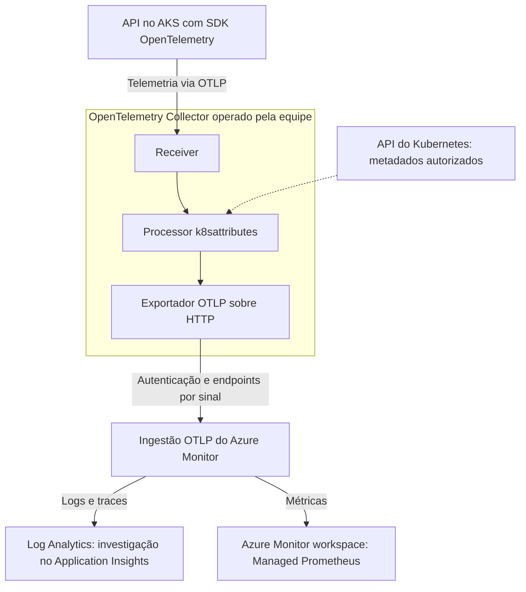
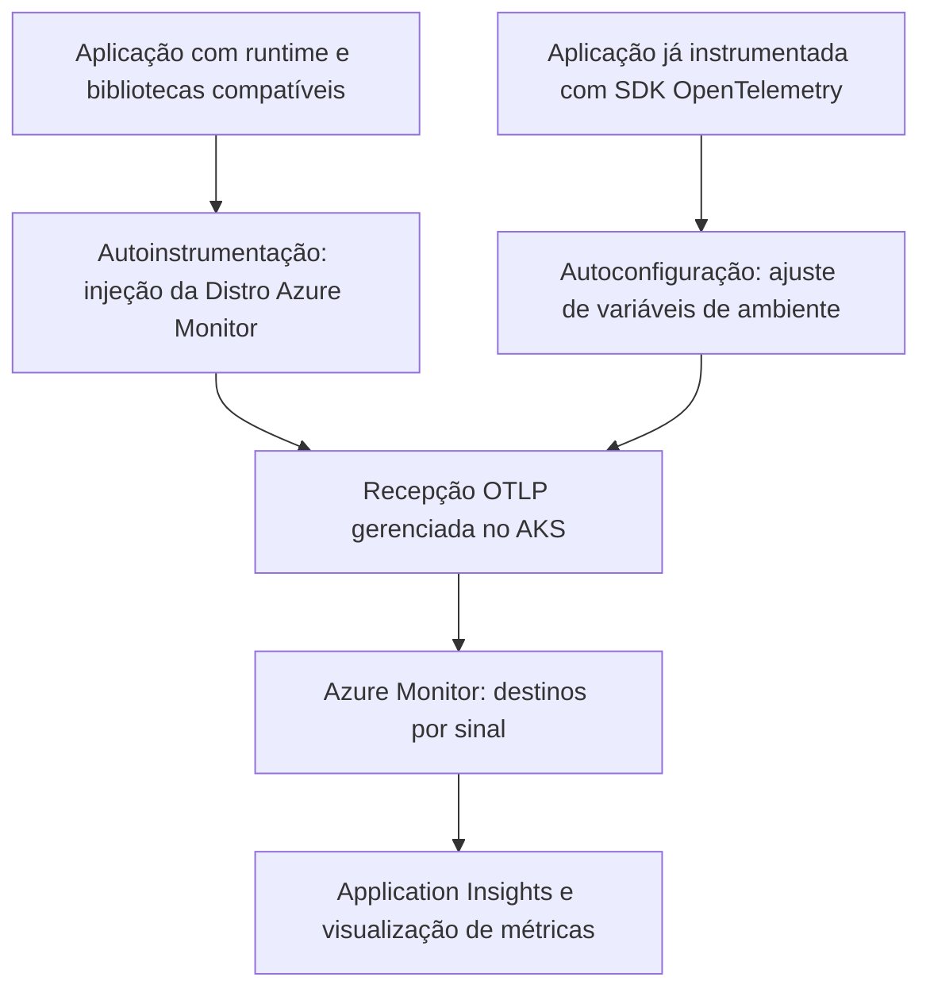

## Introdução: sua app no AKS caiu, e agora?

No artigo [Kubernetes na prática com AKS](/posts/aks-para-iniciantes-container-pod-service-ingress/), uma API Node.js saiu do container e ganhou Pod, Deployment, Service e Ingress. Uma resposta HTTP confirmou o caminho até a aplicação. A pergunta seguinte aparece quando ela responde corretamente quase sempre. O problema mora nesse “quase”.

Imagine uma evolução fictícia daquela API: agora ela consulta um serviço de estoque. Depois de um deploy, algumas requisições ficam lentas e outras falham. Os Pods continuam em execução. A equipe consulta logs de containers diferentes, compara horários e tenta descobrir se os erros pertencem à mesma chamada. Quando alguém encontra uma pista, o Pod já foi substituído.

Falta contexto para investigar. Este primeiro artigo dedicado à observabilidade no RookieOps organiza as peças que ajudam a recuperá-lo: instrumentação, OpenTelemetry Collector, metadados Kubernetes e Azure Monitor. O anúncio do Kubernetes attributes processor v1.0, em setembro de 2026, dá um bom motivo para discutir uma base que continuará relevante depois da novidade.

Você precisa conhecer Pod, Deployment e Service. Ao terminar, deverá conseguir desenhar o caminho da telemetria e explicar quem produz, enriquece, transporta e apresenta cada sinal. Esta é uma análise conceitual, com fontes consultadas em **27 e 28/09/2026**, sem laboratório executado, comandos de implantação ou benchmark próprio. O incidente é ilustrativo.

## Observabilidade não é ter três tipos de dado

Uma forma útil de definir observabilidade é a capacidade de formular novas perguntas sobre o comportamento do sistema usando a telemetria existente, sem publicar código novo para cada investigação. A [introdução do OpenTelemetry](https://opentelemetry.io/docs/concepts/observability-primer/) liga essa capacidade à qualidade da instrumentação. Se uma informação nunca foi registrada, nenhuma ferramenta consegue reconstruí-la por vontade própria.

Na nossa API, as primeiras perguntas são concretas: o problema começou com a nova versão? Acontece em todos os Pods? O tempo foi gasto dentro da aplicação ou esperando o estoque? Um gráfico geral de CPU não resolve sozinho essas dúvidas.

| Sinal    | O que registra                                     | Pergunta no nosso cenário                        |
| -------- | -------------------------------------------------- | ------------------------------------------------ |
| Logs     | Eventos com horário, mensagem e campos de contexto | Qual erro foi registrado naquela operação?       |
| Métricas | Medidas numéricas agregadas ao longo do tempo      | A proporção de falhas aumentou depois do deploy? |
| Traces   | Operações relacionadas que compõem uma requisição  | Em qual chamada o tempo foi consumido?           |

Cada operação de um trace é um **span**, com duração e atributos próprios. Para acompanhar a requisição entre serviços, sua instrumentação precisa propagar o contexto. O trace ID identifica a trajetória; o span ID identifica uma operação. Bibliotecas de logging compatíveis podem registrar esses identificadores e permitir a passagem de um erro para seu trace. A [propagação de contexto](https://opentelemetry.io/docs/concepts/context-propagation/) explica esse vínculo.

Outro vínculo descreve quem produziu o dado. Atributos de recurso como `service.name`, namespace e identidade do Pod permitem separar aplicações que dividem infraestrutura. O nome lógico do serviço deve continuar reconhecível quando suas réplicas mudam. A documentação de [resources](https://opentelemetry.io/docs/concepts/resources/) distingue essa identidade dos detalhes de cada operação.

Na investigação, eu começaria pela taxa de falhas e restringiria o intervalo ao deploy. Depois procuraria traces lentos da mesma versão e os logs associados. A métrica mostra a dimensão do problema; os exemplos individuais ajudam a testar a explicação. Se a coleta preservou somente chamadas bem-sucedidas, essa investigação terá uma lacuna que precisa ser reconhecida.

Não coloque um trace ID como label comum de cada série de métricas. A quantidade de combinações cresceria continuamente. Correlação pode usar serviço, versão e intervalo; exemplars, quando suportados, são amostras de métricas com referência a traces específicos. A decisão de amostragem também determina quais trajetórias estarão disponíveis. Esses detalhes fazem diferença entre um painel útil e um gráfico que só confirma que alguém está reclamando.

## Por que um padrão aberto ajuda na instrumentação

O OpenTelemetry, ou OTel, nasceu da união de OpenTracing e OpenCensus em 2019. A CNCF [anunciou sua graduação em 21 de maio de 2026](https://www.cncf.io/announcements/2026/05/21/cloud-native-computing-foundation-announces-opentelemetrys-graduation-solidifying-status-as-the-de-facto-observability-standard/). Ele passa a ocupar a categoria de maturidade Graduated, também associada a projetos como Kubernetes e Prometheus. Isso diz respeito ao projeto e à sua governança; o status de cada componente continua precisando de consulta.

Para a equipe da API, a vantagem é preservar o investimento na instrumentação. Ao registrar operações por APIs e SDKs do OTel e transportar os sinais por **OTLP**, o OpenTelemetry Protocol, a aplicação pode continuar emitindo os mesmos dados quando o destino muda. Exportadores, autenticação e configuração fazem a ponte com o backend escolhido.

A portabilidade cobre a instrumentação e o transporte. Dashboards, consultas, alertas e recursos exclusivos de um fornecedor ainda exigem adaptação quando o destino muda. O que se reduz é o acoplamento entre o código que descreve a operação e o serviço que armazena e analisa sua telemetria.

Eu trataria nomes de serviço, atributos e significado das operações como um contrato da equipe. “Consulta ao estoque” precisa significar a mesma coisa antes e depois da troca de ferramenta. Se cada destino exigir uma interpretação diferente, o padrão de transporte ajudou, mas o trabalho de padronizar os dados continua pendente.

## A anatomia do OpenTelemetry dentro do cluster

### SDK, instrumentação e Collector

A instrumentação observa operações da aplicação. Pode ser adicionada ao código ou fornecida por bibliotecas que reconhecem frameworks e clientes conhecidos. As APIs oferecem a interface usada para registrar os sinais; os SDKs implementam seu processamento e exportação dentro do processo. A [visão de componentes](https://opentelemetry.io/docs/concepts/components/) separa essas responsabilidades.

O **Collector** é outro processo. Recebe telemetria, executa transformações e a encaminha. A aplicação ainda precisa registrar as operações de negócio relevantes. O armazenamento histórico e a interface de consultas continuam sendo funções do backend.

Uma pipeline tem três peças: **receivers** recebem ou coletam dados; **processors** transformam, filtram ou enriquecem esses dados; **exporters** os enviam ao próximo destino. O processor `k8sattributes` entra na etapa de enriquecimento. A [arquitetura do Collector](https://opentelemetry.io/docs/collector/architecture/) permite compor pipelines diferentes por sinal.

O diagrama apresenta uma arquitetura possível com Collector administrado pela equipe. O exportador faz parte do Collector. Os destinos de armazenamento do Azure aparecem separados para deixar claro onde cada sinal termina.

Esse desenho não descreve o interior do add-on gerenciado do AKS. Nele, a Microsoft administra componentes próprios de integração. Escolher esse add-on não significa instalar automaticamente a versão mais recente de cada processor da comunidade.

### Um agente por nó ou um ponto de agregação

Como **DaemonSet**, o Collector pode executar um agente em cada nó elegível. Isso favorece coleta próxima da origem, como arquivos de logs e métricas do nó. Como **Deployment**, pode atuar como gateway compartilhado, recebendo dados de aplicações ou de outros Collectors. Os padrões [agent](https://opentelemetry.io/docs/collector/deploy/agent/) e [gateway](https://opentelemetry.io/docs/collector/deploy/gateway/) podem coexistir.

Na API de estoque, eu começaria desenhando o caminho mais simples que atendesse à investigação. Uma camada adicional pode centralizar filtragem e exportação, mas também precisa de recursos, supervisão e capacidade de lidar com indisponibilidade. A equipe deve saber onde um dado fica esperando e como percebe perdas antes de culpar a aplicação pelo silêncio.

O desenho também muda a identificação da origem. Se o gateway recebe tudo de um agente intermediário, o IP da conexão pode apontar para esse agente. É necessário preservar uma identidade confiável do Pod original, como seu UID, e configurar a associação adequada. A documentação dos [componentes Kubernetes](https://opentelemetry.io/docs/platforms/kubernetes/collector/components/) ajuda a escolher a topologia conforme o dado coletado.

## O processor que enriquece a telemetria com o cluster virou v1.0

O **Kubernetes attributes processor**, identificado como `k8sattributes`, relaciona telemetria aos objetos do cluster e acrescenta metadados aos seus recursos. Disponível nas distribuições Collector `contrib` e `k8s`, pode identificar Pod, namespace, nó e Deployment. Labels e annotations adicionais dependem da configuração de extração. Para extrair labels de nós, o `ServiceAccount` do Collector precisa de permissões RBAC de escopo de cluster sobre `nodes`, normalmente via `ClusterRole`; uma `Role` limitada ao namespace não basta. Labels de namespaces também exigem acesso de escopo de cluster, conforme o [README do componente](https://github.com/open-telemetry/opentelemetry-collector-contrib/blob/main/processor/k8sattributesprocessor/README.md).

Isso permite conservar o contexto de um erro mesmo depois da substituição do Pod, desde que os dados tenham sido coletados e retidos. A equipe consegue comparar a mesma aplicação entre namespaces, versões e réplicas. A mensagem deixa de ser um recado sem remetente.

### O alcance da estabilidade

O [anúncio de 16 de setembro de 2026](https://opentelemetry.io/blog/2026/k8s-attributes-processor-v1/) apresenta o módulo na versão v1.0.0. A classificação envolve testes, benchmarks, documentação e estabilidade da telemetria. Os [critérios do Collector](https://github.com/open-telemetry/opentelemetry-collector/blob/7d1c25d46b14cce04a820d92a4ce462bf7a04b0b/docs/component-stability.md) estabelecem compromissos de compatibilidade, inclusive de API, dentro da política de versionamento. A equipe ainda precisa planejar correções e migrações futuras.

O caminho passou pelas convenções semânticas: nomes e significados compartilhados entre produtores e consumidores. O conjunto Kubernetes chegou a [Release Candidate em março](https://opentelemetry.io/blog/2026/k8s-semconv-rc/), e atributos centrais de recursos Kubernetes e de registros de imagens de contêineres foram estabilizados na [versão v1.42.0, em junho de 2026](https://github.com/open-telemetry/semantic-conventions/releases/tag/v1.42.0). Já a [seção de métricas de sistema](https://opentelemetry.io/docs/specs/semconv/system/) permanece em desenvolvimento; a estabilidade desses atributos não se estende automaticamente a todas as métricas Kubernetes.

Vale separar três versões: a do módulo `k8sattributes` (v1.0.0), a da distribuição Collector e a das convenções semânticas com as quais esse marco se alinha (v1.42.0). A graduação do projeto na CNCF, a estabilidade do processor e a disponibilidade de uma integração Azure representam compromissos distintos.

### A migração ainda exige trabalho

O [guia de compatibilidade da versão v1.0.0](https://pkg.go.dev/github.com/open-telemetry/opentelemetry-collector-contrib/processor/k8sattributesprocessor@v1.0.0#readme-semantic-conventions-compatibility) registra mudanças como `k8s.pod.labels.<key>` para `k8s.pod.label.<key>` e `container.image.tag` para `container.image.tags`. Os dois feature gates de migração vêm habilitados por padrão, de modo que o processor emite somente o esquema novo. Desabilitar temporariamente `processor.k8sattributes.DontEmitV0K8sConventions` permite emitir ambos durante a transição.

Uma consulta que depende do nome antigo deixa de capturar a nova telemetria após o upgrade com a configuração padrão, a menos que a emissão dupla esteja ativa. Por isso, eu revisaria o atributo desde a extração até o alerta que depende dele. Compararia dados de uma versão piloto, ajustaria os consumidores e só então ampliaria o upgrade. A estabilidade torna os próximos passos mais previsíveis; chegar até ela tem custo de migração.

No cenário da API, a vantagem aparece no painel que agrupa falhas por Deployment. Um contrato de atributos mais estável reduz a chance de a equipe perder essa visão durante um upgrade futuro. Ainda cabe validar se a informação identifica a carga correta.

## Onde o Azure Monitor entra e o que ainda está em preview

**Azure Monitor** reúne serviços de coleta, armazenamento e análise. **Application Insights** oferece investigação do comportamento de aplicações dentro desse conjunto. A **Distro da Microsoft** reúne componentes OpenTelemetry e integrações próprias; o SDK comunitário continua sendo uma escolha distinta.

A [matriz atual de opções da Microsoft](https://learn.microsoft.com/en-us/azure/azure-monitor/containers/opentelemetry-options?wt.mc_id=studentamb_365381) distingue caminhos de ingestão e instrumentação, que não são substitutos diretos:

| Componente ou caminho                     | Papel                                            | Estado em 28/09/2026 |
| ----------------------------------------- | ------------------------------------------------ | -------------------- |
| Microsoft OpenTelemetry Distro            | Instrumentação cliente                           | GA                   |
| Ingestão OTLP com OpenTelemetry Collector | Pipeline operado pela equipe até o Azure Monitor | GA                   |
| Ingestão OTLP com Azure Monitor Agent     | Recepção local em VMs e servidores Arc           | Preview              |
| Integração de aplicações no AKS           | Onboarding gerenciado no cluster                 | Preview              |

GA significa disponibilidade geral. A maturidade da Distro não torna o add-on AKS GA.

A [visão geral de coleta](https://learn.microsoft.com/en-us/azure/azure-monitor/containers/collect-use-observability-data?wt.mc_id=studentamb_365381) ainda rotula o caminho com Collector como preview. Para o estado de disponibilidade, sigo a matriz de opções, que o classifica como GA.

> [!IMPORTANT]
> Em 28/09/2026, a integração gerenciada de aplicações no AKS continua em preview, sem SLA e sem recomendação da Microsoft para cargas de produção. Entre as [limitações do guia AKS](https://learn.microsoft.com/en-us/azure/azure-monitor/containers/kubernetes-open-protocol?wt.mc_id=studentamb_365381) estão node pools Windows, namespaces com Istio mTLS e compressão nos exporters dos SDKs. A [visão geral de coleta](https://learn.microsoft.com/en-us/azure/azure-monitor/containers/collect-use-observability-data?wt.mc_id=studentamb_365381) também lista node pools Linux Arm64 como não suportados. Depois do onboarding, os Deployments precisam ser reiniciados para receber as mudanças.

A nomenclatura também está em transição: a [matriz de opções](https://learn.microsoft.com/en-us/azure/azure-monitor/containers/opentelemetry-options?wt.mc_id=studentamb_365381) apresenta a **Microsoft OpenTelemetry Distro**, com suporte oficial a **.NET, Node.js e Python**. O [onboarding AKS](https://learn.microsoft.com/en-us/azure/azure-monitor/containers/kubernetes-codeless?wt.mc_id=studentamb_365381) chama os componentes injetados de **Azure Monitor OpenTelemetry Distro** e documenta Java e Node.js. Uso o nome de cada caminho; a existência de um pacote não comprova suporte à sua injeção automática no AKS.

No caminho com Collector administrado pela equipe, o [exemplo oficial de exportação](https://learn.microsoft.com/en-us/azure/azure-monitor/containers/opentelemetry-protocol-ingestion?wt.mc_id=studentamb_365381) usa componentes do projeto `contrib`, que inclui o `k8sattributes`, e a extensão `azure_auth` para autenticação Microsoft Entra. A documentação também permite montar uma distribuição própria com o Collector Builder. A identidade precisa de permissão de escrita na Data Collection Rule (DCR). A equipe configura o roteamento e continua responsável pelos componentes comunitários que opera.

### A integração gerenciada de aplicações no AKS

O [onboarding específico do AKS](https://learn.microsoft.com/en-us/azure/azure-monitor/containers/kubernetes-open-protocol?wt.mc_id=studentamb_365381) combina monitoramento do cluster, Application Insights com suporte a OTLP e associação das aplicações por namespace ou Deployment. O uso de workspaces gerenciados provisiona os destinos necessários: Log Analytics para logs e traces e Azure Monitor workspace para métricas Prometheus. O workspace de métricas da aplicação deve ser distinto daquele usado para infraestrutura.

Os dois workspaces de métricas respondem a perguntas diferentes:

- **Infraestrutura:** reúne métricas da saúde do cluster, nós e pressão de recursos. É uma visão que a equipe de plataforma normalmente acompanha.
- **Aplicação:** reúne métricas de requisições e operações instrumentadas. Ajuda a equipe de desenvolvimento a investigar o comportamento do serviço.

Para nossa API, um nó saudável ainda pode hospedar um processo que espera uma dependência além do tempo aceitável. Logs e traces seguem para o Log Analytics. A associação feita no onboarding ajuda a navegar entre as visões, mas a equipe ainda precisa conferir quais atributos Kubernetes chegaram aos dados da aplicação.

Eu colocaria a responsabilidade pelo cluster e pelos destinos compartilhados com a equipe de plataforma. A equipe da aplicação escolheria as operações relevantes, seus atributos e os critérios de falha. As duas precisam acordar nomenclatura, retenção e o procedimento para investigar dados ausentes.

### Autoinstrumentação e autoconfiguração

Na **autoinstrumentação**, a plataforma injeta os componentes da Azure Monitor OpenTelemetry Distro para observar bibliotecas compatíveis, sem exigir que cada operação técnica seja instrumentada manualmente. A [documentação de AKS](https://learn.microsoft.com/en-us/azure/azure-monitor/containers/kubernetes-codeless?wt.mc_id=studentamb_365381) apresenta Java e Node.js. O suporte à autoinstrumentação de [.NET e Python](https://learn.microsoft.com/en-us/azure/azure-monitor/containers/kubernetes-codeless-python-net?wt.mc_id=studentamb_365381) permanece em preview público limitado.

Na **autoconfiguração**, a aplicação já possui instrumentação OpenTelemetry. A plataforma ajusta variáveis de ambiente para direcionar seus SDKs ao caminho gerenciado. Sem um SDK já presente, não há instrumentação da aplicação para configurar, nem operações de negócio novas surgirão dessa etapa.

As setas convergem para a mesma integração de recepção, não para uma promessa de URL e porta únicas para todos os sinais. Nesse caminho, a equipe não precisa operar um Collector comunitário. O primeiro diagrama mostra a alternativa autogerenciada, não os componentes internos do add-on.

Para a API Node.js fictícia, eu avaliaria a autoinstrumentação se a prioridade fosse obter uma primeira visão das requisições e dependências suportadas. Se a equipe já mantém instrumentação OpenTelemetry, a autoconfiguração é o caminho natural: aproveita o SDK existente sem injetar outra Distro.

Há dois casos de coexistência que não devem ser confundidos. A [Microsoft documenta](https://learn.microsoft.com/en-us/azure/azure-monitor/containers/kubernetes-codeless?wt.mc_id=studentamb_365381) que a autoinstrumentação evita dados duplicados ao coexistir com a Azure Monitor OpenTelemetry Distro ou o SDK clássico do Application Insights. Já a injeção pode afetar o envio a terceiros por um SDK OpenTelemetry comunitário. Quando as instrumentações coexistem, em Node.js prevalece a manual; em Java, a automática. Métricas customizadas em Node.js exigem instrumentação manual com a Azure Monitor OpenTelemetry Distro.

Pelo portal, um namespace recebe autoinstrumentação **ou** autoconfiguração. Para combinar as duas escolhas no mesmo namespace, o onboarding deve ser feito por Deployment, conforme o [guia de AKS](https://learn.microsoft.com/en-us/azure/azure-monitor/containers/kubernetes-open-protocol?wt.mc_id=studentamb_365381).

### Portas e transporte OTLP: 4317, 4318 e 4319

As portas convencionais do OTLP são **4317 para gRPC e 4318 para HTTP**. Esses números descrevem o protocolo, não a configuração de todo ambiente. No caminho específico do [Azure Monitor Agent em máquinas](https://learn.microsoft.com/en-us/azure/azure-monitor/containers/opentelemetry-ingest-agent?wt.mc_id=studentamb_365381), a recepção local gRPC usa 4317 para métricas e **4319 para logs e traces**. A 4319 é uma escolha dessa implementação em VMs e servidores habilitados pelo Azure Arc, não uma porta genérica do AKS.

Na seção **Change protocol**, o [guia específico do AKS](https://learn.microsoft.com/en-us/azure/azure-monitor/containers/kubernetes-open-protocol?wt.mc_id=studentamb_365381) diz que a autoconfiguração usa `http/protobuf` por padrão e mostra como selecionar gRPC. Na seção **Limits**, a mesma página restringe o recurso a OTLP/HTTP ou OTLP/gRPC com Protobuf binário, sem JSON. Há uma divergência documental: a [visão geral de coleta](https://learn.microsoft.com/en-us/azure/azure-monitor/containers/collect-use-observability-data?wt.mc_id=studentamb_365381) descreve a integração AKS como limitada a HTTP/protobuf, sem gRPC. Confirme o transporte disponível no seu ambiente em preview antes de configurar o exporter. Endereço, transporte e formato não podem ser copiados de outro caminho.

## Depois que os dados chegam: onde você olha

As experiências **Performance**, **Failures**, **Search** e **Transaction details** do Application Insights ajudam a investigar duração, falhas e operações relacionadas. A documentação das [experiências com dados OTel](https://learn.microsoft.com/en-us/azure/azure-monitor/containers/collect-use-observability-data?wt.mc_id=studentamb_365381) também registra uma diferença relevante: Live Metrics não está disponível nesse caminho OTLP.

Logs e traces chegam ao Log Analytics com um schema baseado nas convenções OTel. A tabela [OTelSpans](https://learn.microsoft.com/en-us/azure/azure-monitor/reference/tables/otelspans?wt.mc_id=studentamb_365381), por exemplo, documenta os spans recebidos. Confira em `ResourceAttributes` e no registro `OTelResources` ligado por `ResourceAttributesId` se os atributos `k8s.*` esperados foram ingeridos. Consultas antigas devem ser conferidas contra o schema efetivo. Não basta trocar o destino da ingestão e assumir que todos os nomes de tabelas permaneceram iguais.

Para métricas, o Azure Monitor workspace oferece o armazenamento Prometheus. [Dashboards com Grafana no Application Insights](https://learn.microsoft.com/en-us/azure/azure-monitor/app/grafana-dashboards?wt.mc_id=studentamb_365381) são uma experiência integrada ao portal; Azure Managed Grafana é uma opção separada. No caminho OTel, o [Metrics Explorer pode exigir PromQL manual](https://learn.microsoft.com/en-us/azure/azure-monitor/containers/collect-use-observability-data?wt.mc_id=studentamb_365381).

As experiências prontas esperam métricas com temporalidade **delta**, referente ao intervalo exportado, e histogramas exponenciais, que agrupam medições por faixas. O onboarding AKS ajusta essas opções automaticamente. Em uma pipeline própria, a equipe precisa conferir esse contrato para que os dashboards interpretem as agregações corretamente. Se a origem emitir métricas cumulativas, a [documentação do Collector para Azure Monitor](https://learn.microsoft.com/en-us/azure/azure-monitor/containers/opentelemetry-protocol-ingestion?wt.mc_id=studentamb_365381) indica o processor `cumulativetodelta` para convertê-las.

Na nossa API, abriria um trace lento a partir do intervalo em que as falhas cresceram. Se a espera estiver concentrada na chamada de estoque, compararia exemplos de réplicas e versões diferentes. Um log correlacionado pode acrescentar o motivo do timeout. Essa sequência testa uma hipótese; a coincidência de dois gráficos não comprova causalidade.

### Como reconhecer que a observabilidade está ajudando

Antes de ampliar a coleta, eu exigiria evidências simples do piloto:

- uma requisição conhecida pode ser localizada por serviço, versão e origem Kubernetes;
- logs emitidos dentro da operação apontam para o trace esperado;
- uma falha controlada aparece na investigação e no indicador agregado;
- a substituição de um Pod preserva a identificação histórica dos dados já enviados;
- perdas de exportação e efeitos da amostragem são reconhecidos pela equipe.

Também definiria quais dados não devem ser coletados, como tokens e corpos de requisição com informação pessoal. Volume, cardinalidade e retenção afetam custo e desempenho, mesmo sem discutirmos preços. Para reverter um piloto, a equipe precisa recuperar a configuração anterior de instrumentação e manter disponíveis os registros necessários à comparação.

## Conclusão: o próximo passo depois de colocar algo para rodar no AKS

A API continua dependendo de Pods, Services e rede para atender. Agora a equipe tem condições de perguntar de qual réplica veio a falha, seguir a operação até o estoque e comparar seu comportamento com a versão anterior. Isso depende de sinais corretamente produzidos e correlacionados, além de um caminho confiável até a análise.

O SDK trabalha na aplicação; o Collector recebe e processa; o `k8sattributes` acrescenta contexto do cluster; uma Distro reúne escolhas de instrumentação e integração; Application Insights oferece experiências de investigação. Entender essa divisão ajuda a localizar tanto o defeito da aplicação quanto uma falha na própria coleta.

Eu começaria com uma pergunta operacional importante e uma aplicação pequena. O processor estável melhora a previsibilidade do contrato de metadados. A plataforma escolhida precisa provar que preserva esse contrato até a investigação. Um próximo artigo poderá transformar esse desenho em laboratório, com configuração, validação e limpeza dos recursos.

No seu cluster, o que mais atrapalha uma investigação: encontrar o Pod certo, correlacionar logs e traces ou perceber perdas na coleta? Conte nos comentários. Sua experiência pode ajudar a escolher o foco desse futuro laboratório.

## Referências

Fontes primárias consultadas em 27 e 28/09/2026. Os links no corpo acompanham as afirmações específicas. Para retomar as decisões principais:

- [Fundamentos de observabilidade](https://opentelemetry.io/docs/concepts/observability-primer/).
- [Kubernetes attributes processor v1.0](https://opentelemetry.io/blog/2026/k8s-attributes-processor-v1/).
- [Compatibilidade das convenções na versão v1.0.0](https://pkg.go.dev/github.com/open-telemetry/opentelemetry-collector-contrib/processor/k8sattributesprocessor@v1.0.0#readme-semantic-conventions-compatibility).
- [Caminhos OpenTelemetry e disponibilidade no Azure Monitor](https://learn.microsoft.com/en-us/azure/azure-monitor/containers/opentelemetry-options?wt.mc_id=studentamb_365381).
- [Integração OTLP de aplicações no AKS](https://learn.microsoft.com/en-us/azure/azure-monitor/containers/kubernetes-open-protocol?wt.mc_id=studentamb_365381).
- [Ingestão direta com OpenTelemetry Collector](https://learn.microsoft.com/en-us/azure/azure-monitor/containers/opentelemetry-protocol-ingestion?wt.mc_id=studentamb_365381).
